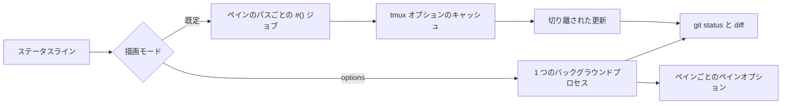

<div align="center">

# tmux-git-revamped

<strong>アクティブなペインのgitブランチ、変更、プロバイダーの件数を、描画を止めずにtmuxのステータスバーに表示します。</strong>

[English](README.md) | 日本語 | [简体中文](README.zh-Hans.md) | [繁體中文（香港）](README.zh-HK.md)

[](https://github.com/tmux-revamped/tmux-git-revamped/actions/workflows/family.yml)
[](https://github.com/tmux-revamped/tmux-git-revamped/actions/workflows/tests.yml)
[](https://github.com/tmux-revamped/tmux-git-revamped/releases/latest)
[](https://scorecard.dev/viewer/?uri=github.com/tmux-revamped/tmux-git-revamped)
[](LICENSE)

<p align="center">
  <a href="#できること">できること</a> |
  <a href="#動作要件">動作要件</a> |
  <a href="#インストール">インストール</a> |
  <a href="#使い方">使い方</a> |
  <a href="#設定">設定</a> |
  <a href="#キーバインド">キーバインド</a> |
  <a href="#仕組み">仕組み</a> |
  <a href="#開発">開発</a>
</p>

</div>

プレースホルダーは**2**個、ブランチ名の後に続くセグメントは**21**個で、それぞれに色とアイコンのオプションがあります。キャッシュした値はすべてファイルではなくtmuxのオプションに保持します。

---

## できること

`#{git}`はアクティブなペインのリポジトリを表示します。ブランチに続いて、変更されたファイル数、追加行数と削除行数、未追跡ファイル数、マージの競合数、進行中のrebase、merge、cherry-pick、revert、bisect、amを表示します。既定のASCIIアイコンでは、変更のあるツリーは次のように表示されます。

```text
main ~ 2 + 7 - 1 ? 3
```

オプトインのセグメントでは、ステージ済みファイル、スタッシュ、upstreamに対する先行と遅れのコミット数、upstreamの参照、ベースブランチより先行しているコミット数、リンクされたworktreeのフラグ、変更のあるサブモジュール、最後のコミットからの経過時間、クリーンなツリーのフラグ、そしてGitHubまたはGitLabのオープンなプルリクエスト、レビュー依頼、issue、バグ、CIの状態を追加できます。

リポジトリの外では、どちらのプレースホルダーも何も表示しません。detached HEADでは、`HEAD`の代わりに短いコミットハッシュと最も近いタグを表示します。

## 動作要件

| 要件 | バージョンまたは補足 |
|:------------|:----------------|
| tmux | 3.2以降 |
| bash | 3.2以降。macOSの`/bin/bash`で動作します |
| git | `PATH`上にあること |
| `gh`または`glab`、任意 | ログイン済みであること。プロバイダーセグメントとbrowseアクションで使います |
| lazygit、任意 | lazygitアクションで使います |
| [Nerd Font](https://www.nerdfonts.com)、任意 | `@git_revamped_icons 'nerd'`で使います |

CIは、Linux x86_64とarm64ではGNU coreutilsとuutils coreutilsで、macOSのApple SiliconとIntelではシステムのBSDツール、GNU coreutils、uutils coreutilsでテストスイートを実行します。

## インストール

[TPM](https://github.com/tmux-plugins/tpm)を使う場合は、`~/.tmux.conf`にプラグインを追加して`prefix + I`を押します。

```tmux
set -g @plugin 'tmux-revamped/tmux-git-revamped'
```

TPMを使わない場合は、リポジトリをクローンし、`~/.tmux.conf`からエントリポイントを実行します。

```sh
git clone https://github.com/tmux-revamped/tmux-git-revamped ~/.tmux/plugins/tmux-git-revamped
```

```tmux
run-shell ~/.tmux/plugins/tmux-git-revamped/git-revamped.tmux
```

エントリポイントは`status-left`と`status-right`にあるプレースホルダーを置き換えるので、これらはプラグインの読み込み前に設定してください。

## 使い方

`status-left`または`status-right`にプレースホルダーを書きます。

```tmux
set -g status-right '#{git} | %H:%M'
```

| プレースホルダー | 出力 |
|:------------|:-------|
| `#{git}` | アクティブなペインのリポジトリの完全なステータス |
| `#{git_branch}` | ブランチ名のみ |

必要なセグメントを有効にします。

```tmux
set -g @git_revamped_ahead_behind '1'
set -g @git_revamped_stash '1'
set -g @git_revamped_web '1'
```

`doctor`サブコマンドは、バージョン、パスがリポジトリかどうか、`git`、`gh`、`glab`、`lazygit`のうち見つかったもの、検出したプロバイダー、tmuxがポップアップに対応しているかを表示します。

```sh
~/.tmux/plugins/tmux-git-revamped/src/git.sh doctor "$PWD"
```

## 設定

| オプション | 既定値 | 意味 |
|:-------|:--------|:--------|
| `@git_revamped_render` | 未設定 | `options`にすると、仕組みの節で説明するoptions描画モードに切り替わります |
| `@git_revamped_interval` | `5` | キャッシュしたステータスが新しいとみなされる秒数。optionsモードのプロセスの周期でもあります |
| `@git_revamped_max_branch` | `25` | ブランチ名を切り詰めて`...`で終える長さ |
| `@git_revamped_untracked` | `1` | `0`で未追跡ファイル数を隠します |
| `@git_revamped_staged` | `0` | `1`でステージ済みファイル数を表示します |
| `@git_revamped_conflict` | `1` | `0`で競合数を隠します |
| `@git_revamped_state` | `1` | `0`でrebase、merge、cherry-pick、revert、bisect、amのラベルを隠します。rebaseとamは手順を`X/Y`で表示します |
| `@git_revamped_stash` | `0` | `1`でスタッシュ数を表示します |
| `@git_revamped_ahead_behind` | `0` | `1`でupstreamに対する先行と遅れのコミット数を表示します |
| `@git_revamped_autofetch` | `0` | `1`で`git fetch --prune --tags`をバックグラウンドで実行し、先行と遅れの数を最新に保ちます |
| `@git_revamped_autofetch_interval` | `5` | 1つのリポジトリをバックグラウンドでfetchする間隔の分数 |
| `@git_revamped_last_commit` | `0` | `1`で最後のコミットからの経過時間を`m`、`h`、`d`で表示します |
| `@git_revamped_upstream` | `0` | `1`でupstreamの参照を表示し、upstreamがないブランチでは`local`を表示します |
| `@git_revamped_base_branch` | 空 | `main`などのブランチ名。そのブランチにない`HEAD`上のコミット数を表示します |
| `@git_revamped_worktree` | `0` | `1`でリンクされたworktreeにフラグを付けます |
| `@git_revamped_submodule` | `0` | `1`で、チェックアウトが記録されたコミットと異なるサブモジュールの数を表示します |
| `@git_revamped_clean` | `0` | `1`で、変更も未追跡ファイルもないときにフラグを表示します |
| `@git_revamped_web` | `0` | `1`でプロバイダーセグメントを追加します |
| `@git_revamped_web_interval` | `300` | プロバイダーセグメントをキャッシュする秒数 |
| `@git_revamped_web_zero` | `1` | `0`で0件のプロバイダーの件数を隠します |
| `@git_revamped_ci` | `1` | `0`でプロバイダーセグメントからCIの状態を外します |
| `@git_revamped_gh_accounts` | 空 | リポジトリの所有者ごとに`gh`のアカウントを指定する、スペース区切りの`owner=account`の組 |
| `@git_revamped_key_menu` | `M-v` | ブランチメニューのキー。`''`にすると何もバインドしません |
| `@git_revamped_key_lazygit` | 未設定 | lazygitアクションのキー |
| `@git_revamped_key_browse` | 未設定 | browseアクションのキー |
| `@git_revamped_before` | 空 | ステータスが空でないときだけ、ステータスの前に置くフォーマット |
| `@git_revamped_after` | 空 | ステータスが空でないときだけ、ステータスの後に置くフォーマット |
| `@git_revamped_reset` | `#[default]` | 各セグメントを閉じるスタイル。単純な`#[fg=...]`にすると、`@git_revamped_before`で設定した背景を保てます |
| `@git_revamped_icons` | `ascii` | 既定のアイコンセット。`ascii`または`nerd` |

### セグメントのスタイル

各セグメントは`@git_revamped_<kind>_color`と`@git_revamped_<kind>_icon`を読みます。アイコンのオプションを`''`にすると値だけを表示します。ブランチ名は`@git_revamped_branch_color`と`@git_revamped_branch_icon`を読み、どちらも既定では空です。

| 種類 | 既定の色 | `ascii`アイコン | `nerd`グリフ |
|:-----|:--------------|:-------------|:-------------|
| `branch` | なし | なし | なし |
| `changed` | yellow | `~` | `oct-diff_modified` |
| `insertions` | green | `+` | `oct-diff_added` |
| `deletions` | red | `-` | `oct-diff_removed` |
| `untracked` | blue | `?` | `md-file_question_outline` |
| `staged` | green | `S` | `md-check_all` |
| `conflict` | red | `!` | `oct-alert` |
| `state` | yellow | なし | `oct-git_merge` |
| `stash` | magenta | `$` | `md-archive` |
| `ahead` | green | `^` | `md-arrow_up` |
| `behind` | yellow | `v` | `md-arrow_down` |
| `commit` | blue | `@` | `oct-history` |
| `upstream` | cyan | `->` | `oct-git_compare` |
| `noupstream` | yellow | `!` | `md-cloud_off_outline` |
| `divergence` | magenta | `~>` | `md-source_fork` |
| `worktree` | cyan | `wt` | `md-folder_multiple_outline` |
| `submodule` | yellow | `sub` | `oct-file_submodule` |
| `clean` | green | `ok` | `md-check` |
| `pr` | cyan | `PR` | `oct-git_pull_request` |
| `review` | magenta | `R` | `oct-eye` |
| `issue` | blue | `I` | `oct-issue_opened` |
| `bug` | red | `B` | `fa-bug` |

worktreeとcleanのセグメントはフラグなので、アイコンだけを表示します。色はANSIの16色名なので、端末のテーマに従います。

CIの状態には専用のオプションがあります。`@git_revamped_ci_pass_color`、`@git_revamped_ci_fail_color`、`@git_revamped_ci_pending_color`の既定値はgreen、red、yellowです。`@git_revamped_ci_<status>_icon`の既定値は`CI`で、Nerd Fontアイコンでは`md-check_circle`、`md-close_circle`、`md-clock_outline`です。`@git_revamped_ci_<status>_label`の既定値は状態名で、ラベルを空にするとアイコンだけを表示します。

### プロバイダーセグメント

`@git_revamped_web`を`1`にすると、オープンなプルリクエスト、レビュー依頼、自分に割り当てられたissue、現在のブランチのCIの状態がステータスに加わります。GitHubには`gh`、GitLabには`glab`を使い、コマンドはアクティブなペインのリポジトリ内で実行します。GitHubでは、`bug`ラベルの付いた割り当て済みissueは独立したセグメントになり、issueの件数からは除かれます。GitHubの一覧は最大1000件を要求し、GitLabの一覧は100件ずつ最大10ページを読みます。

プロバイダーは`remote.origin.url`から判定します。`git@github-work:owner/repo.git`のようなSSHのホストエイリアスは`ssh -G`で解決します。GitHubのアカウントは、プロジェクトの`user.email`が`299237933+octocat@users.noreply.github.com`のようなnoreplyアドレスならそのログイン名、次にリポジトリの所有者に対応する`@git_revamped_gh_accounts`のエントリ、最後に`gh`で有効なアカウントの順に決まります。トークンは`gh auth token --user <account>`から取得するので、すべてのアカウントが`gh`にログインしている必要があります。

10秒を超えたプロバイダーの呼び出しは停止され、最後の値が表示されたまま残ります。更新のたびにプロバイダーのAPIを呼ぶので、その頻度は`@git_revamped_web_interval`で決まります。

### テーマカラー

リポジトリの外では消えるCatppuccinのピルは、ステータスの前後で開閉し、セグメントをまたいで背景を保ちます。

```tmux
set -g @git_revamped_before "#[fg=#{@thm_peach}]#{@catppuccin_status_left_separator}#[fg=#{@thm_crust},bg=#{@thm_peach}]\U000f02a2 #{@catppuccin_status_middle_separator}#[fg=#{@thm_fg},bg=#{@thm_surface_0}] "
set -g @git_revamped_after '#[fg=#{@thm_surface_0}]#{@catppuccin_status_right_separator}'
set -g @git_revamped_reset '#[fg=#{@thm_fg}]'
```

正確な16進数の色を使うには、次のブロックのいずれかを`~/.tmux.conf`にコピーします。

#### Catppuccin Mocha

```tmux
set -g @git_revamped_insertions_color '#[fg=#a6e3a1]'
set -g @git_revamped_ahead_color '#[fg=#a6e3a1]'
set -g @git_revamped_changed_color '#[fg=#f9e2af]'
set -g @git_revamped_behind_color '#[fg=#f9e2af]'
set -g @git_revamped_deletions_color '#[fg=#f38ba8]'
set -g @git_revamped_bug_color '#[fg=#f38ba8]'
set -g @git_revamped_untracked_color '#[fg=#89b4fa]'
set -g @git_revamped_commit_color '#[fg=#89b4fa]'
set -g @git_revamped_issue_color '#[fg=#89b4fa]'
set -g @git_revamped_pr_color '#[fg=#94e2d5]'
set -g @git_revamped_stash_color '#[fg=#cba6f7]'
set -g @git_revamped_review_color '#[fg=#cba6f7]'
```

#### Dracula

```tmux
set -g @git_revamped_insertions_color '#[fg=#50fa7b]'
set -g @git_revamped_ahead_color '#[fg=#50fa7b]'
set -g @git_revamped_changed_color '#[fg=#f1fa8c]'
set -g @git_revamped_behind_color '#[fg=#f1fa8c]'
set -g @git_revamped_deletions_color '#[fg=#ff5555]'
set -g @git_revamped_bug_color '#[fg=#ff5555]'
set -g @git_revamped_untracked_color '#[fg=#bd93f9]'
set -g @git_revamped_commit_color '#[fg=#bd93f9]'
set -g @git_revamped_issue_color '#[fg=#bd93f9]'
set -g @git_revamped_pr_color '#[fg=#8be9fd]'
set -g @git_revamped_stash_color '#[fg=#ff79c6]'
set -g @git_revamped_review_color '#[fg=#ff79c6]'
```

#### Nord

```tmux
set -g @git_revamped_insertions_color '#[fg=#a3be8c]'
set -g @git_revamped_ahead_color '#[fg=#a3be8c]'
set -g @git_revamped_changed_color '#[fg=#ebcb8b]'
set -g @git_revamped_behind_color '#[fg=#ebcb8b]'
set -g @git_revamped_deletions_color '#[fg=#bf616a]'
set -g @git_revamped_bug_color '#[fg=#bf616a]'
set -g @git_revamped_untracked_color '#[fg=#81a1c1]'
set -g @git_revamped_commit_color '#[fg=#81a1c1]'
set -g @git_revamped_issue_color '#[fg=#81a1c1]'
set -g @git_revamped_pr_color '#[fg=#88c0d0]'
set -g @git_revamped_stash_color '#[fg=#b48ead]'
set -g @git_revamped_review_color '#[fg=#b48ead]'
```

#### Gruvbox Dark

```tmux
set -g @git_revamped_insertions_color '#[fg=#b8bb26]'
set -g @git_revamped_ahead_color '#[fg=#b8bb26]'
set -g @git_revamped_changed_color '#[fg=#fabd2f]'
set -g @git_revamped_behind_color '#[fg=#fabd2f]'
set -g @git_revamped_deletions_color '#[fg=#fb4934]'
set -g @git_revamped_bug_color '#[fg=#fb4934]'
set -g @git_revamped_untracked_color '#[fg=#83a598]'
set -g @git_revamped_commit_color '#[fg=#83a598]'
set -g @git_revamped_issue_color '#[fg=#83a598]'
set -g @git_revamped_pr_color '#[fg=#8ec07c]'
set -g @git_revamped_stash_color '#[fg=#d3869b]'
set -g @git_revamped_review_color '#[fg=#d3869b]'
```

#### Tokyo Night

```tmux
set -g @git_revamped_insertions_color '#[fg=#9ece6a]'
set -g @git_revamped_ahead_color '#[fg=#9ece6a]'
set -g @git_revamped_changed_color '#[fg=#e0af68]'
set -g @git_revamped_behind_color '#[fg=#e0af68]'
set -g @git_revamped_deletions_color '#[fg=#f7768e]'
set -g @git_revamped_bug_color '#[fg=#f7768e]'
set -g @git_revamped_untracked_color '#[fg=#7aa2f7]'
set -g @git_revamped_commit_color '#[fg=#7aa2f7]'
set -g @git_revamped_issue_color '#[fg=#7aa2f7]'
set -g @git_revamped_pr_color '#[fg=#7dcfff]'
set -g @git_revamped_stash_color '#[fg=#bb9af7]'
set -g @git_revamped_review_color '#[fg=#bb9af7]'
```

#### Solarized Dark

```tmux
set -g @git_revamped_insertions_color '#[fg=#859900]'
set -g @git_revamped_ahead_color '#[fg=#859900]'
set -g @git_revamped_changed_color '#[fg=#b58900]'
set -g @git_revamped_behind_color '#[fg=#b58900]'
set -g @git_revamped_deletions_color '#[fg=#dc322f]'
set -g @git_revamped_bug_color '#[fg=#dc322f]'
set -g @git_revamped_untracked_color '#[fg=#268bd2]'
set -g @git_revamped_commit_color '#[fg=#268bd2]'
set -g @git_revamped_issue_color '#[fg=#268bd2]'
set -g @git_revamped_pr_color '#[fg=#2aa198]'
set -g @git_revamped_stash_color '#[fg=#d33682]'
set -g @git_revamped_review_color '#[fg=#d33682]'
```

### 内部状態

これらのオプションはプラグインが管理します。設定しないでください。

| オプション | 保持する内容 |
|:-------|:------|
| `@git_revamped_published` | ステータスラインが使うメトリクスのスペース区切りの一覧。読み込み時に書き込まれ、options描画モードはこれらだけを公開します |
| `@git_revamped_out_status`、`@git_revamped_out_branch` | options描画モードで、各ペインの描画済みの値を保持するペインオプション |
| `@git_revamped_ticker_pid` | optionsモードのバックグラウンドプロセスのプロセスID。既定のモードでは読み込み時に消去され、古いプロセスが終了します |
| `@git_revamped_option_names` | バックグラウンドプロセスが周期ごとに1回の呼び出しで読むオプション名 |
| `@git_revamped_status_*`、`@git_revamped_web_status_*`、`@git_revamped_fetch_status_*` | リポジトリごとにキャッシュしたステータス、プロバイダーセグメント、最後のfetch時刻。パスのチェックサムをキーとし、`_ts`と`_lock`を伴います |

## キーバインド

| キー | アクション | 既定 |
|:----|:-------|:--------|
| `prefix + M-v` | ブランチメニュー。ローカルブランチを一覧し、選んだブランチをチェックアウトします。作業ツリーに変更があるときは実行しません | バインド済み |
| `@git_revamped_key_lazygit` | ペインのディレクトリを起点に、90%のポップアップでlazygitを開きます | 未バインド |
| `@git_revamped_key_browse` | `gh browse`または`glab repo view --web`でリポジトリをブラウザーで開きます | 未バインド |

`M-v`はファミリーのキー割り当てにおけるこのプラグインの枠で、`g`が使用済みのためversion controlから選ばれました。各アクションは、ペインがリポジトリ内にあり、必要なツールがインストールされているときだけ実行されます。

```tmux
set -g @git_revamped_key_lazygit 'g'
set -g @git_revamped_key_browse 'o'
```

## 仕組み



エントリポイントの[`git-revamped.tmux`](git-revamped.tmux)は、`status-left`と`status-right`の各プレースホルダーを置き換えます。

既定のモードでは、プレースホルダーは`#{q:pane_current_path}`を渡して[`src/git.sh`](src/git.sh)を呼ぶ`#()`になります。この呼び出しは、そのパスのキャッシュ済みの値をすぐに出力します。値が`@git_revamped_interval`より古ければ、切り離された更新を開始し、`git status`、`git diff --numstat`などの読み取りをすべて`--no-optional-locks`付きで実行します。ロック用のオプションにより、同じリポジトリの更新が同時に2つ走ることはありません。tmuxは新しいパスごとに新しいジョブを開始するため、前面のプログラムが別のディレクトリで動いていると、そのジョブが終わるまでセグメントは空になります。

`@git_revamped_render`を`options`にすると、プレースホルダーは`#{E:@git_revamped_out_status}`または`#{E:@git_revamped_out_branch}`になります。サーバーごとに1つのバックグラウンドプロセスが`@git_revamped_interval`秒ごとにすべてのペインを巡回し、各ペインの値をペインオプションとして書き込むので、ペインを切り替えるとそのペインのリポジトリがすぐに表示されます。リポジトリの外にあるペインは最後の値を保ちます。このプロセスはサーバーが停止すると現在の周期の後に終了し、設定を再読み込みすると置き換わります。

ブランチ名、タグ名、upstreamの名前は、ステータスラインに届く前にすべての`#`を二重にするので、`fix/#(cmd)`のような名前もそのまま表示されます。

## 開発

| コマンド | 実行する内容 |
|:--------|:-------------|
| `make test` | [`test/`](test)以下のbatsスイート |
| `make lint` | すべてのシェルファイルと[`family/bin/`](family/bin)に対するwarningレベルのshellcheck |
| `make coverage` | Linuxでのkcovによる行カバレッジ。95%を下回ると失敗します |

[`src/lib/git/git.sh`](src/lib/git/git.sh)のパーサーと[`src/lib/git/render.sh`](src/lib/git/render.sh)のレンダラーは、gitの出力を受け取る純粋関数です。git、`gh`、`glab`の呼び出しは小さなラッパーの裏にあるので、ほとんどのテストはリポジトリもネットワークも必要としません。

## ライセンス

[MIT](LICENSE)、copyright Gustavo Franco。

<!-- family:begin -->

## tmux-revamped ファミリー

このプラグインは tmux-revamped ファミリーの一員です。すべてのメンバーが [`FAMILY.md`](FAMILY.md) の同じ規約、`family/` 配下の同じツール、同じ共有ライブラリを持ち、チェックサムの一覧によってバイト単位で同一に保たれています。メンバーは一緒にインストールする前提で作られており、ほかのメンバーが使うキーや tmux オプションを使うメンバーはありません。

あるメンバーで見つかった不具合は、修正完了とする前に全メンバーで同じ不具合を探します。この義務は記憶に頼らず規約に書かれており、`family/bin/sweep` がその作業を行います。

| メンバー | 機能 |
|---|---|
| [`tmux-autoreload-revamped`](https://github.com/tmux-revamped/tmux-autoreload-revamped) | tmuxの設定を編集して保存するだけで、キーもコマンドも使わずに自動で再読み込みされます |
| [`tmux-battery-revamped`](https://github.com/tmux-revamped/tmux-battery-revamped) | tmuxのステータスバーに電池の状態を表示し、ステータスの描画を一切止めません |
| [`tmux-bluetooth-revamped`](https://github.com/tmux-revamped/tmux-bluetooth-revamped) | 接続中のすべてのBluetooth機器とその電池残量をtmuxのステータスバーに表示し、描画を止めません |
| [`tmux-cpu-revamped`](https://github.com/tmux-revamped/tmux-cpu-revamped) | CPUの負荷、温度、周波数をtmuxのステータスバーに表示し、描画を一切止めません |
| [`tmux-disk-revamped`](https://github.com/tmux-revamped/tmux-disk-revamped) | tmuxのステータスバーにディスク使用量を表示し、ステータスの描画を一切止めません |
| [`tmux-extract-revamped`](https://github.com/tmux-revamped/tmux-extract-revamped) | 画面上の URL、パス、ハッシュなどのトークンを fzf で選び、カーソル位置に入力します。純粋なシェルだけで動きます |
| [`tmux-fzf-revamped`](https://github.com/tmux-revamped/tmux-fzf-revamped) | ポップアップ内の fzf ピッカーから、tmux のセッション、ウィンドウ、ペインの切り替え、終了、名前変更、作成を行います |
| [`tmux-git-revamped`](https://github.com/tmux-revamped/tmux-git-revamped) | **このプラグイン**、アクティブなペインのgitブランチ、変更、プロバイダーの件数を、描画を止めずにtmuxのステータスバーに表示します |
| [`tmux-gpu-revamped`](https://github.com/tmux-revamped/tmux-gpu-revamped) | NVIDIA、AMD、Intel、Apple の GPU の負荷、温度、クロック、電力、メモリを tmux のステータスバーに表示します |
| [`tmux-kube-revamped`](https://github.com/tmux-revamped/tmux-kube-revamped) | 現在の Kubernetes コンテキストと名前空間を、kubectl を使わずに kubeconfig から解析して tmux のステータスバーに表示します |
| [`tmux-launcher-revamped`](https://github.com/tmux-revamped/tmux-launcher-revamped) | 任意の TUI アプリを、現在のペインのディレクトリでポップアップまたはウィンドウとして起動します。アプリごとにキーを設定できます |
| [`tmux-logging-revamped`](https://github.com/tmux-revamped/tmux-logging-revamped) | 任意のペインをファイルに保存します。ライブのログ記録、スクロールバック全体、1 回限りのスクリーンショットに対応します |
| [`tmux-music-revamped`](https://github.com/tmux-revamped/tmux-music-revamped) | 再生中の曲をステータスバーに表示し、ステータスの描画を止めません |
| [`tmux-network-revamped`](https://github.com/tmux-revamped/tmux-network-revamped) | ネットワークのスループットをステータスバーに表示し、描画を止めません |
| [`tmux-pain-control-revamped`](https://github.com/tmux-revamped/tmux-pain-control-revamped) | tmux のペインとウィンドウの操作キー。tmux のバージョンに対応し、vim と共存でき、どの prefix キーも無効にできます |
| [`tmux-persist-revamped`](https://github.com/tmux-revamped/tmux-persist-revamped) | tmuxのすべてのセッション、ウィンドウ、ペインを保存し、タイマーで自動保存して、再起動後にすべて復元します |
| [`tmux-plugin-template`](https://github.com/tmux-revamped/tmux-plugin-template) | tmux-revampedプラグインの出発点です。共有ライブラリ、batsハーネス、CI、ファミリーのツールを含みます |
| [`tmux-pomodoro-revamped`](https://github.com/tmux-revamped/tmux-pomodoro-revamped) | すべての状態をtmuxオプションに保持し、一時ファイルを使わない、tmuxステータスバーのポモドーロタイマーです |
| [`tmux-ram-revamped`](https://github.com/tmux-revamped/tmux-ram-revamped) | RAM、スワップ、メモリプレッシャーをtmuxのステータスバーに表示します。計測はバックグラウンドで行うため描画を待たせません |
| [`tmux-reorder-revamped`](https://github.com/tmux-revamped/tmux-reorder-revamped) | tmuxのステータスバー上でウィンドウのタブをマウスでドラッグして、そのウィンドウを移動します |
| [`tmux-scroll-revamped`](https://github.com/tmux-revamped/tmux-scroll-revamped) | 自分でスクロールできるアプリにはマウスホイールを渡し、それ以外ではtmuxのコピーモードに入ります |
| [`tmux-sensible-revamped`](https://github.com/tmux-revamped/tmux-sensible-revamped) | tmuxのバージョンと端末に合わせて適用され、ユーザーが設定したオプションには触れない、妥当な初期設定です |
| [`tmux-tiling-revamped`](https://github.com/tmux-revamped/tmux-tiling-revamped) | tmuxのタイル型ウィンドウ管理です。BSPのdwindleとspiralを含む8つのレイアウトと、レイアウトの取り消しがあります |
| [`tmux-time-revamped`](https://github.com/tmux-revamped/tmux-time-revamped) | ステータスバーにローカル時計と世界時計を時間帯ごとの色で表示し、カウントダウンと夏時間の警告も出します |
| [`tmux-weather-revamped`](https://github.com/tmux-revamped/tmux-weather-revamped) | wttr.inの天気をバックグラウンドで取得し、ステータスバーを待たせずに表示します |

### インストールの確認

全メンバーがディスク上にあれば、1 つのコマンドでメンバー間の衝突を報告できます。

```sh
family/bin/doctor --live
```

各メンバーと実行中の tmux サーバーを読み取り、重複したキー、重複したステータスのプレースホルダー、命名規則に合わないオプション、規約のバージョンが古いメンバーを報告します。

<!-- family:end -->
