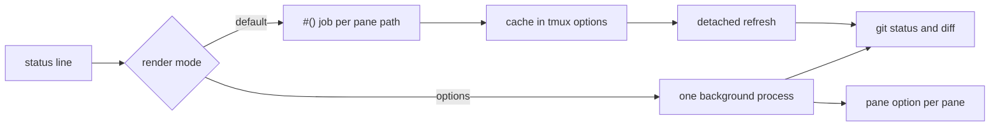

<div align="center">

# tmux-git-revamped

<strong>Show the active pane's git branch, changes and provider counts in the tmux status bar without blocking it.</strong>

English | [日本語](README.ja.md) | [简体中文](README.zh-Hans.md) | [繁體中文（香港）](README.zh-HK.md)

[](https://github.com/tmux-revamped/tmux-git-revamped/actions/workflows/family.yml)
[](https://github.com/tmux-revamped/tmux-git-revamped/actions/workflows/tests.yml)
[](https://github.com/tmux-revamped/tmux-git-revamped/releases/latest)
[](https://scorecard.dev/viewer/?uri=github.com/tmux-revamped/tmux-git-revamped)
[](LICENSE)

<p align="center">
  <a href="#what-it-does">What it does</a> |
  <a href="#requirements">Requirements</a> |
  <a href="#installation">Installation</a> |
  <a href="#usage">Usage</a> |
  <a href="#configuration">Configuration</a> |
  <a href="#key-bindings">Key bindings</a> |
  <a href="#how-it-works">How it works</a> |
  <a href="#development">Development</a>
</p>

</div>

**2** placeholders, **21** segments after the branch name, each with its own color and icon option, and every cached value held in tmux options instead of files.

---

## What it does

`#{git}` shows the repository of the active pane: the branch, then the count of changed files, inserted and deleted lines, untracked files, merge conflicts and any rebase, merge, cherry-pick, revert, bisect or am in progress. With the default ASCII icons a dirty tree reads like this:

```text
main ~ 2 + 7 - 1 ? 3
```

Opt-in segments add staged files, stashes, commits ahead and behind, the upstream ref, commits ahead of a base branch, a linked-worktree flag, dirty submodules, the age of the last commit, a clean-tree flag, and open pull requests, review requests, issues, bugs and CI status from GitHub or GitLab.

Outside a repository both placeholders render nothing. A detached HEAD shows the short commit hash and the nearest tag instead of `HEAD`.

## Requirements

| Requirement | Version or note |
|:------------|:----------------|
| tmux | 3.2 or later |
| bash | 3.2 or later, so the macOS `/bin/bash` works |
| git | on `PATH` |
| `gh` or `glab`, optional | logged in, for the provider segment and the browse action |
| lazygit, optional | for the lazygit action |
| [Nerd Font](https://www.nerdfonts.com), optional | for `@git_revamped_icons 'nerd'` |

CI runs the suite on Linux x86_64 and arm64 with GNU and uutils coreutils, and on macOS Apple Silicon and Intel with the system BSD tools, GNU coreutils and uutils coreutils.

## Installation

With [TPM](https://github.com/tmux-plugins/tpm), add the plugin to `~/.tmux.conf` and press `prefix + I`:

```tmux
set -g @plugin 'tmux-revamped/tmux-git-revamped'
```

Without TPM, clone the repository and run the entrypoint from `~/.tmux.conf`:

```sh
git clone https://github.com/tmux-revamped/tmux-git-revamped ~/.tmux/plugins/tmux-git-revamped
```

```tmux
run-shell ~/.tmux/plugins/tmux-git-revamped/git-revamped.tmux
```

Set `status-left` or `status-right` before the plugin loads, because the entrypoint replaces the placeholders it finds there.

## Usage

Put a placeholder in `status-left` or `status-right`:

```tmux
set -g status-right '#{git} | %H:%M'
```

| Placeholder | Output |
|:------------|:-------|
| `#{git}` | the full status of the active pane's repository |
| `#{git_branch}` | the branch name only |

Turn on the segments you want:

```tmux
set -g @git_revamped_ahead_behind '1'
set -g @git_revamped_stash '1'
set -g @git_revamped_web '1'
```

The `doctor` subcommand prints the version, whether the path is a repository, which of `git`, `gh`, `glab` and `lazygit` were found, the detected provider, and whether tmux supports popups:

```sh
~/.tmux/plugins/tmux-git-revamped/src/git.sh doctor "$PWD"
```

## Configuration

| Option | Default | Meaning |
|:-------|:--------|:--------|
| `@git_revamped_render` | unset | `options` switches to the options render mode described under How it works |
| `@git_revamped_interval` | `5` | seconds a cached status stays fresh, and the tick of the options-mode process |
| `@git_revamped_max_branch` | `25` | branch length before it is cut and ends in `...` |
| `@git_revamped_untracked` | `1` | `0` hides the untracked count |
| `@git_revamped_staged` | `0` | `1` shows the staged count |
| `@git_revamped_conflict` | `1` | `0` hides the conflict count |
| `@git_revamped_state` | `1` | `0` hides the rebase, merge, cherry-pick, revert, bisect or am label; a rebase or am shows its step as `X/Y` |
| `@git_revamped_stash` | `0` | `1` shows the stash count |
| `@git_revamped_ahead_behind` | `0` | `1` shows commits ahead of and behind the upstream |
| `@git_revamped_autofetch` | `0` | `1` runs `git fetch --prune --tags` in the background so ahead and behind stay current |
| `@git_revamped_autofetch_interval` | `5` | minutes between background fetches of one repository |
| `@git_revamped_last_commit` | `0` | `1` shows the age of the last commit in `m`, `h` or `d` |
| `@git_revamped_upstream` | `0` | `1` shows the upstream ref, or `local` when the branch has none |
| `@git_revamped_base_branch` | empty | a branch such as `main`; shows the commits on `HEAD` that are not on it |
| `@git_revamped_worktree` | `0` | `1` flags a linked worktree |
| `@git_revamped_submodule` | `0` | `1` shows the count of submodules whose checkout differs from the recorded commit |
| `@git_revamped_clean` | `0` | `1` shows a flag when nothing is modified or untracked |
| `@git_revamped_web` | `0` | `1` adds the provider segment |
| `@git_revamped_web_interval` | `300` | seconds the provider segment stays cached |
| `@git_revamped_web_zero` | `1` | `0` hides provider counts that are zero |
| `@git_revamped_ci` | `1` | `0` drops the CI status from the provider segment |
| `@git_revamped_gh_accounts` | empty | space-separated `owner=account` pairs naming the `gh` account for a repository owner |
| `@git_revamped_key_menu` | `M-v` | key for the branch menu; `''` binds nothing |
| `@git_revamped_key_lazygit` | unset | key for the lazygit action |
| `@git_revamped_key_browse` | unset | key for the browse action |
| `@git_revamped_before` | empty | format placed before the status, only when the status is not empty |
| `@git_revamped_after` | empty | format placed after the status, only when the status is not empty |
| `@git_revamped_reset` | `#[default]` | style that closes every segment; a plain `#[fg=...]` keeps a background set by `@git_revamped_before` |
| `@git_revamped_icons` | `ascii` | default icon set: `ascii` or `nerd` |

### Segment styles

Every segment reads `@git_revamped_<kind>_color` and `@git_revamped_<kind>_icon`. An icon option set to `''` shows the value alone. The branch name reads `@git_revamped_branch_color` and `@git_revamped_branch_icon`, both empty by default.

| Kind | Default color | `ascii` icon | `nerd` glyph |
|:-----|:--------------|:-------------|:-------------|
| `branch` | none | none | none |
| `changed` | yellow | `~` | `oct-diff_modified` |
| `insertions` | green | `+` | `oct-diff_added` |
| `deletions` | red | `-` | `oct-diff_removed` |
| `untracked` | blue | `?` | `md-file_question_outline` |
| `staged` | green | `S` | `md-check_all` |
| `conflict` | red | `!` | `oct-alert` |
| `state` | yellow | none | `oct-git_merge` |
| `stash` | magenta | `$` | `md-archive` |
| `ahead` | green | `^` | `md-arrow_up` |
| `behind` | yellow | `v` | `md-arrow_down` |
| `commit` | blue | `@` | `oct-history` |
| `upstream` | cyan | `->` | `oct-git_compare` |
| `noupstream` | yellow | `!` | `md-cloud_off_outline` |
| `divergence` | magenta | `~>` | `md-source_fork` |
| `worktree` | cyan | `wt` | `md-folder_multiple_outline` |
| `submodule` | yellow | `sub` | `oct-file_submodule` |
| `clean` | green | `ok` | `md-check` |
| `pr` | cyan | `PR` | `oct-git_pull_request` |
| `review` | magenta | `R` | `oct-eye` |
| `issue` | blue | `I` | `oct-issue_opened` |
| `bug` | red | `B` | `fa-bug` |

The worktree and clean segments are flags and render their icon alone. The colors are the 16 ANSI names, so they follow the terminal theme.

The CI status has its own options. `@git_revamped_ci_pass_color`, `@git_revamped_ci_fail_color` and `@git_revamped_ci_pending_color` default to green, red and yellow. `@git_revamped_ci_<status>_icon` defaults to `CI`, or to `md-check_circle`, `md-close_circle` and `md-clock_outline` with Nerd Font icons. `@git_revamped_ci_<status>_label` defaults to the status name, and an empty label shows the icon alone.

### Provider segment

With `@git_revamped_web` set to `1`, the status adds open pull requests, review requests, issues assigned to you and the CI status of the current branch. GitHub goes through `gh`, GitLab through `glab`, and the commands run inside the repository of the active pane. On GitHub, assigned issues labeled `bug` form their own segment and leave the issue count. GitHub lists ask for up to 1000 items, and GitLab lists read up to 10 pages of 100.

The provider is read from `remote.origin.url`. An SSH host alias such as `git@github-work:owner/repo.git` is resolved through `ssh -G`. On GitHub, the account is the login in the project's `user.email` when it is a noreply address such as `299237933+octocat@users.noreply.github.com`, then the `@git_revamped_gh_accounts` entry for the repository owner, then the active `gh` account. The token comes from `gh auth token --user <account>`, so every account must be logged in to `gh`.

A provider call that runs longer than 10 seconds is stopped, and the last value stays on screen. Each refresh calls the provider API, so `@git_revamped_web_interval` sets how often that happens.

### Theme colors

A Catppuccin pill that disappears outside a repository opens and closes around the status and keeps its background across segments:

```tmux
set -g @git_revamped_before "#[fg=#{@thm_peach}]#{@catppuccin_status_left_separator}#[fg=#{@thm_crust},bg=#{@thm_peach}]\U000f02a2 #{@catppuccin_status_middle_separator}#[fg=#{@thm_fg},bg=#{@thm_surface_0}] "
set -g @git_revamped_after '#[fg=#{@thm_surface_0}]#{@catppuccin_status_right_separator}'
set -g @git_revamped_reset '#[fg=#{@thm_fg}]'
```

For exact hex values, copy one block into `~/.tmux.conf`.

#### Catppuccin Mocha

```tmux
set -g @git_revamped_insertions_color '#[fg=#a6e3a1]'
set -g @git_revamped_ahead_color '#[fg=#a6e3a1]'
set -g @git_revamped_changed_color '#[fg=#f9e2af]'
set -g @git_revamped_behind_color '#[fg=#f9e2af]'
set -g @git_revamped_deletions_color '#[fg=#f38ba8]'
set -g @git_revamped_bug_color '#[fg=#f38ba8]'
set -g @git_revamped_untracked_color '#[fg=#89b4fa]'
set -g @git_revamped_commit_color '#[fg=#89b4fa]'
set -g @git_revamped_issue_color '#[fg=#89b4fa]'
set -g @git_revamped_pr_color '#[fg=#94e2d5]'
set -g @git_revamped_stash_color '#[fg=#cba6f7]'
set -g @git_revamped_review_color '#[fg=#cba6f7]'
```

#### Dracula

```tmux
set -g @git_revamped_insertions_color '#[fg=#50fa7b]'
set -g @git_revamped_ahead_color '#[fg=#50fa7b]'
set -g @git_revamped_changed_color '#[fg=#f1fa8c]'
set -g @git_revamped_behind_color '#[fg=#f1fa8c]'
set -g @git_revamped_deletions_color '#[fg=#ff5555]'
set -g @git_revamped_bug_color '#[fg=#ff5555]'
set -g @git_revamped_untracked_color '#[fg=#bd93f9]'
set -g @git_revamped_commit_color '#[fg=#bd93f9]'
set -g @git_revamped_issue_color '#[fg=#bd93f9]'
set -g @git_revamped_pr_color '#[fg=#8be9fd]'
set -g @git_revamped_stash_color '#[fg=#ff79c6]'
set -g @git_revamped_review_color '#[fg=#ff79c6]'
```

#### Nord

```tmux
set -g @git_revamped_insertions_color '#[fg=#a3be8c]'
set -g @git_revamped_ahead_color '#[fg=#a3be8c]'
set -g @git_revamped_changed_color '#[fg=#ebcb8b]'
set -g @git_revamped_behind_color '#[fg=#ebcb8b]'
set -g @git_revamped_deletions_color '#[fg=#bf616a]'
set -g @git_revamped_bug_color '#[fg=#bf616a]'
set -g @git_revamped_untracked_color '#[fg=#81a1c1]'
set -g @git_revamped_commit_color '#[fg=#81a1c1]'
set -g @git_revamped_issue_color '#[fg=#81a1c1]'
set -g @git_revamped_pr_color '#[fg=#88c0d0]'
set -g @git_revamped_stash_color '#[fg=#b48ead]'
set -g @git_revamped_review_color '#[fg=#b48ead]'
```

#### Gruvbox Dark

```tmux
set -g @git_revamped_insertions_color '#[fg=#b8bb26]'
set -g @git_revamped_ahead_color '#[fg=#b8bb26]'
set -g @git_revamped_changed_color '#[fg=#fabd2f]'
set -g @git_revamped_behind_color '#[fg=#fabd2f]'
set -g @git_revamped_deletions_color '#[fg=#fb4934]'
set -g @git_revamped_bug_color '#[fg=#fb4934]'
set -g @git_revamped_untracked_color '#[fg=#83a598]'
set -g @git_revamped_commit_color '#[fg=#83a598]'
set -g @git_revamped_issue_color '#[fg=#83a598]'
set -g @git_revamped_pr_color '#[fg=#8ec07c]'
set -g @git_revamped_stash_color '#[fg=#d3869b]'
set -g @git_revamped_review_color '#[fg=#d3869b]'
```

#### Tokyo Night

```tmux
set -g @git_revamped_insertions_color '#[fg=#9ece6a]'
set -g @git_revamped_ahead_color '#[fg=#9ece6a]'
set -g @git_revamped_changed_color '#[fg=#e0af68]'
set -g @git_revamped_behind_color '#[fg=#e0af68]'
set -g @git_revamped_deletions_color '#[fg=#f7768e]'
set -g @git_revamped_bug_color '#[fg=#f7768e]'
set -g @git_revamped_untracked_color '#[fg=#7aa2f7]'
set -g @git_revamped_commit_color '#[fg=#7aa2f7]'
set -g @git_revamped_issue_color '#[fg=#7aa2f7]'
set -g @git_revamped_pr_color '#[fg=#7dcfff]'
set -g @git_revamped_stash_color '#[fg=#bb9af7]'
set -g @git_revamped_review_color '#[fg=#bb9af7]'
```

#### Solarized Dark

```tmux
set -g @git_revamped_insertions_color '#[fg=#859900]'
set -g @git_revamped_ahead_color '#[fg=#859900]'
set -g @git_revamped_changed_color '#[fg=#b58900]'
set -g @git_revamped_behind_color '#[fg=#b58900]'
set -g @git_revamped_deletions_color '#[fg=#dc322f]'
set -g @git_revamped_bug_color '#[fg=#dc322f]'
set -g @git_revamped_untracked_color '#[fg=#268bd2]'
set -g @git_revamped_commit_color '#[fg=#268bd2]'
set -g @git_revamped_issue_color '#[fg=#268bd2]'
set -g @git_revamped_pr_color '#[fg=#2aa198]'
set -g @git_revamped_stash_color '#[fg=#d33682]'
set -g @git_revamped_review_color '#[fg=#d33682]'
```

### Internal state

The plugin manages these options itself. Do not set them.

| Option | Holds |
|:-------|:------|
| `@git_revamped_published` | space-separated metrics the status line uses, written at load so the options render mode publishes only those |
| `@git_revamped_out_status`, `@git_revamped_out_branch` | pane options holding each pane's rendered value in the options render mode |
| `@git_revamped_ticker_pid` | process id of the options-mode background process, cleared at load in the default mode so an old process exits |
| `@git_revamped_option_names` | option names the background process reads in one call per tick |
| `@git_revamped_status_*`, `@git_revamped_web_status_*`, `@git_revamped_fetch_status_*` | cached status, provider segment and last fetch time per repository, keyed by a checksum of the path, with `_ts` and `_lock` companions |

## Key bindings

| Key | Action | Default |
|:----|:-------|:--------|
| `prefix + M-v` | branch menu: lists local branches and checks out the chosen one, refusing while the working tree is dirty | bound |
| `@git_revamped_key_lazygit` | lazygit in a 90% popup rooted at the pane's directory | unbound |
| `@git_revamped_key_browse` | open the repository in the browser through `gh browse` or `glab repo view --web` | unbound |

`M-v` is this plugin's slot in the family key allocation, chosen for version control because `g` is taken. Each action runs only when the pane is inside a repository and the tool it needs is installed.

```tmux
set -g @git_revamped_key_lazygit 'g'
set -g @git_revamped_key_browse 'o'
```

## How it works



The entrypoint [`git-revamped.tmux`](git-revamped.tmux) replaces each placeholder in `status-left` and `status-right`.

In the default mode a placeholder becomes a `#()` call to [`src/git.sh`](src/git.sh) with `#{q:pane_current_path}`. The call prints the cached value for that path at once. When the value is older than `@git_revamped_interval`, it starts a detached refresh that runs `git status`, `git diff --numstat` and the other reads, all with `--no-optional-locks`. A lock option keeps two refreshes of one repository from running together. Because tmux starts a new job for every new path, the segment renders empty until that job finishes when the foreground program works in another directory.

With `@git_revamped_render` set to `options`, a placeholder becomes `#{E:@git_revamped_out_status}` or `#{E:@git_revamped_out_branch}`. One background process per server walks every pane every `@git_revamped_interval` seconds and writes each pane's value as a pane option, so switching panes shows that pane's repository at once. A pane outside a repository keeps its last value. The process exits after its current tick when the server stops, and a config reload replaces it.

Branch, tag and upstream names have every `#` doubled before they reach the status line, so a name such as `fix/#(cmd)` shows literally.

## Development

| Command | What it runs |
|:--------|:-------------|
| `make test` | the bats suite under [`test/`](test) |
| `make lint` | shellcheck at warning severity on every shell file and [`family/bin/`](family/bin) |
| `make coverage` | kcov line coverage on Linux, failing below 95% |

The parsers in [`src/lib/git/git.sh`](src/lib/git/git.sh) and the renderers in [`src/lib/git/render.sh`](src/lib/git/render.sh) are pure functions over git output. The git, `gh` and `glab` calls sit behind small wrappers, so most tests need no repository and no network.

## License

[MIT](LICENSE), copyright Gustavo Franco.

<!-- family:begin -->

## The tmux-revamped family

This plugin is one member of the tmux-revamped family. Every member carries the
same contract in [`FAMILY.md`](FAMILY.md), the same tooling under `family/`, and
the same shared library, all held byte-identical by a checksum manifest. They are
built to be installed together: no member claims a key or a tmux option that
another member claims.

A defect found in one member is hunted across all of them before the fix is
called done. That obligation is written into the contract rather than left to
memory, and `family/bin/sweep` is how it is discharged.

| Member | What it does |
|---|---|
| [`tmux-autoreload-revamped`](https://github.com/tmux-revamped/tmux-autoreload-revamped) | Edit your tmux config, save, and watch it reload itself, no key, no command |
| [`tmux-battery-revamped`](https://github.com/tmux-revamped/tmux-battery-revamped) | Battery status for your tmux status bar, without ever blocking the status render |
| [`tmux-bluetooth-revamped`](https://github.com/tmux-revamped/tmux-bluetooth-revamped) | Every connected Bluetooth device and its battery in your tmux status bar, without blocking the render |
| [`tmux-cpu-revamped`](https://github.com/tmux-revamped/tmux-cpu-revamped) | CPU load, temperature, and frequency in your tmux status bar, without ever blocking the render |
| [`tmux-disk-revamped`](https://github.com/tmux-revamped/tmux-disk-revamped) | Disk usage for your tmux status bar, without ever blocking the status render |
| [`tmux-extract-revamped`](https://github.com/tmux-revamped/tmux-extract-revamped) | Pick a URL, path, hash or any other token off the screen with fzf and type it at the cursor, in pure shell |
| [`tmux-fzf-revamped`](https://github.com/tmux-revamped/tmux-fzf-revamped) | Switch to, kill, rename or create tmux sessions, windows and panes from fzf pickers in a popup |
| [`tmux-git-revamped`](https://github.com/tmux-revamped/tmux-git-revamped) | **this plugin**, Show the active pane's git branch, changes and provider counts in the tmux status bar without blocking it |
| [`tmux-gpu-revamped`](https://github.com/tmux-revamped/tmux-gpu-revamped) | GPU load, temperature, clock, power and memory in the tmux status bar, from NVIDIA, AMD, Intel and Apple GPUs |
| [`tmux-kube-revamped`](https://github.com/tmux-revamped/tmux-kube-revamped) | Current Kubernetes context and namespace in the tmux status bar, parsed from kubeconfig without kubectl |
| [`tmux-launcher-revamped`](https://github.com/tmux-revamped/tmux-launcher-revamped) | Launch any TUI app in a popup or a window, scoped to the current pane's directory, with one configurable bindi |
| [`tmux-logging-revamped`](https://github.com/tmux-revamped/tmux-logging-revamped) | Capture any pane to a file: live logging, full scrollback, or a one-shot screenshot |
| [`tmux-music-revamped`](https://github.com/tmux-revamped/tmux-music-revamped) | Now playing in your tmux status bar, without ever blocking the status render |
| [`tmux-network-revamped`](https://github.com/tmux-revamped/tmux-network-revamped) | Network throughput in your tmux status bar, without ever blocking the render |
| [`tmux-pain-control-revamped`](https://github.com/tmux-revamped/tmux-pain-control-revamped) | Pane and window management bindings for tmux, version aware, vim friendly, every prefix key can be disabled |
| [`tmux-persist-revamped`](https://github.com/tmux-revamped/tmux-persist-revamped) | Save every tmux session, window and pane, auto-save on a timer, and restore it all after a reboot |
| [`tmux-plugin-template`](https://github.com/tmux-revamped/tmux-plugin-template) | The starting point for a tmux-revamped plugin: shared library, bats harness, CI and family tooling |
| [`tmux-pomodoro-revamped`](https://github.com/tmux-revamped/tmux-pomodoro-revamped) | A Pomodoro timer in the tmux status bar that keeps all of its state in tmux options, with no temp files |
| [`tmux-ram-revamped`](https://github.com/tmux-revamped/tmux-ram-revamped) | RAM, swap and memory pressure in the tmux status bar, sampled in the background so the render never waits |
| [`tmux-reorder-revamped`](https://github.com/tmux-revamped/tmux-reorder-revamped) | Drag a window tab along the tmux status bar with the mouse to move that window |
| [`tmux-scroll-revamped`](https://github.com/tmux-revamped/tmux-scroll-revamped) | Send the mouse wheel to apps that scroll themselves and into tmux copy-mode everywhere else |
| [`tmux-sensible-revamped`](https://github.com/tmux-revamped/tmux-sensible-revamped) | Sensible tmux defaults, gated by tmux version and terminal, that leave the options you set alone |
| [`tmux-tiling-revamped`](https://github.com/tmux-revamped/tmux-tiling-revamped) | Tiling window management for tmux: eight layouts including BSP dwindle and spiral, with layout undo |
| [`tmux-time-revamped`](https://github.com/tmux-revamped/tmux-time-revamped) | Local and world clocks for the tmux status bar, colored by time of day, with countdowns and a DST warning |
| [`tmux-weather-revamped`](https://github.com/tmux-revamped/tmux-weather-revamped) | Weather for the tmux status bar from wttr.in, fetched in the background so the status line never waits |

### Checking an installation

With every member on disk, one command reports any conflict between them:

```sh
family/bin/doctor --live
```

It reads each member and the running tmux server, and reports duplicate keys,
duplicate status placeholders, options outside the naming grammar, and any
member whose contract version has fallen behind.

<!-- family:end -->
