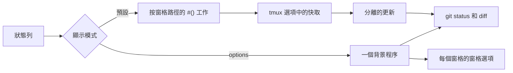

<div align="center">

# tmux-git-revamped

<strong>在 tmux 狀態列顯示當前窗格的 git 分支、改動和託管平台數目，而不會阻塞顯示。</strong>

[English](README.md) | [日本語](README.ja.md) | [简体中文](README.zh-Hans.md) | 繁體中文（香港）

[](https://github.com/tmux-revamped/tmux-git-revamped/actions/workflows/tests.yml)
[](LICENSE)
[](CHANGELOG.md)

<p align="center">
  <a href="#功能">功能</a> |
  <a href="#系統要求">系統要求</a> |
  <a href="#安裝">安裝</a> |
  <a href="#用法">用法</a> |
  <a href="#設定">設定</a> |
  <a href="#按鍵綁定">按鍵綁定</a> |
  <a href="#運作原理">運作原理</a> |
  <a href="#開發">開發</a>
</p>

</div>

**2** 個佔位符，分支名稱之後有 **21** 個區段，每個區段都有自己的顏色和圖示選項，所有快取值都存放在 tmux 選項中，而非檔案。

---

## 功能

`#{git}` 顯示當前窗格所在的儲存庫：先是分支，然後是改動的檔案數、新增和刪除的行數、未追蹤檔案數、合併衝突數，以及正在進行的 rebase、merge、cherry-pick、revert、bisect 或 am。使用預設的 ASCII 圖示時，有改動的工作樹顯示如下：

```text
main ~ 2 + 7 - 1 ? 3
```

選用區段可加入已暫存檔案、stash、相對 upstream 領先和落後的提交數、upstream 參照、領先於基準分支的提交數、連結 worktree 標記、有改動的子模組、最近一次提交距今的時間、乾淨工作樹標記，以及來自 GitHub 或 GitLab 的開放拉取請求、審閱請求、issue、bug 和 CI 狀態。

在儲存庫以外，兩個佔位符都不顯示任何內容。處於 detached HEAD 時，會顯示簡短的提交雜湊和最近的標籤，而不是 `HEAD`。

## 系統要求

| 要求 | 版本或說明 |
|:------------|:----------------|
| tmux | 3.2 或以上 |
| bash | 3.2 或以上，因此 macOS 的 `/bin/bash` 可用 |
| git | 位於 `PATH` 中 |
| `gh` 或 `glab`，選用 | 須已登入，用於託管平台區段和 browse 動作 |
| lazygit，選用 | 用於 lazygit 動作 |
| [Nerd Font](https://www.nerdfonts.com)，選用 | 用於 `@git_revamped_icons 'nerd'` |

CI 在 Linux x86_64 和 arm64 上以 GNU coreutils 和 uutils coreutils 執行測試套件，在 macOS Apple Silicon 和 Intel 上以系統 BSD 工具、GNU coreutils 和 uutils coreutils 執行測試套件。

## 安裝

使用 [TPM](https://github.com/tmux-plugins/tpm) 時，把插件加入 `~/.tmux.conf`，然後按 `prefix + I`：

```tmux
set -g @plugin 'tmux-revamped/tmux-git-revamped'
```

不使用 TPM 時，複製儲存庫，並在 `~/.tmux.conf` 中執行入口腳本：

```sh
git clone https://github.com/tmux-revamped/tmux-git-revamped ~/.tmux/plugins/tmux-git-revamped
```

```tmux
run-shell ~/.tmux/plugins/tmux-git-revamped/git-revamped.tmux
```

請在插件載入前設定 `status-left` 或 `status-right`，因為入口腳本會取代其中的佔位符。

## 用法

在 `status-left` 或 `status-right` 中放入佔位符：

```tmux
set -g status-right '#{git} | %H:%M'
```

| 佔位符 | 輸出 |
|:------------|:-------|
| `#{git}` | 當前窗格所在儲存庫的完整狀態 |
| `#{git_branch}` | 只有分支名稱 |

開啟所需的區段：

```tmux
set -g @git_revamped_ahead_behind '1'
set -g @git_revamped_stash '1'
set -g @git_revamped_web '1'
```

`doctor` 子命令會輸出版本、路徑是否為儲存庫、找到 `git`、`gh`、`glab` 和 `lazygit` 中的哪些、偵測到的託管平台，以及 tmux 是否支援彈出視窗：

```sh
~/.tmux/plugins/tmux-git-revamped/src/git.sh doctor "$PWD"
```

## 設定

| 選項 | 預設值 | 意思 |
|:-------|:--------|:--------|
| `@git_revamped_render` | 未設定 | 設為 `options` 時切換至運作原理一節所述的 options 顯示模式 |
| `@git_revamped_interval` | `5` | 快取狀態保持有效的秒數，亦是 options 模式程序的週期 |
| `@git_revamped_max_branch` | `25` | 分支名稱被截短並以 `...` 結尾前的長度 |
| `@git_revamped_untracked` | `1` | 設為 `0` 隱藏未追蹤檔案數 |
| `@git_revamped_staged` | `0` | 設為 `1` 顯示已暫存檔案數 |
| `@git_revamped_conflict` | `1` | 設為 `0` 隱藏衝突數 |
| `@git_revamped_state` | `1` | 設為 `0` 隱藏 rebase、merge、cherry-pick、revert、bisect 或 am 標籤；rebase 和 am 以 `X/Y` 顯示目前步驟 |
| `@git_revamped_stash` | `0` | 設為 `1` 顯示 stash 數目 |
| `@git_revamped_ahead_behind` | `0` | 設為 `1` 顯示相對 upstream 領先和落後的提交數 |
| `@git_revamped_autofetch` | `0` | 設為 `1` 在背景執行 `git fetch --prune --tags`，令領先和落後數保持最新 |
| `@git_revamped_autofetch_interval` | `5` | 同一儲存庫兩次背景 fetch 之間的分鐘數 |
| `@git_revamped_last_commit` | `0` | 設為 `1` 以 `m`、`h` 或 `d` 顯示最近一次提交距今的時間 |
| `@git_revamped_upstream` | `0` | 設為 `1` 顯示 upstream 參照，分支沒有 upstream 時顯示 `local` |
| `@git_revamped_base_branch` | 空 | 一個分支名稱，例如 `main`；顯示 `HEAD` 上不在該分支中的提交數 |
| `@git_revamped_worktree` | `0` | 設為 `1` 標記連結 worktree |
| `@git_revamped_submodule` | `0` | 設為 `1` 顯示簽出版本與記錄的提交不一致的子模組數目 |
| `@git_revamped_clean` | `0` | 設為 `1` 在沒有改動和未追蹤檔案時顯示標記 |
| `@git_revamped_web` | `0` | 設為 `1` 加入託管平台區段 |
| `@git_revamped_web_interval` | `300` | 託管平台區段的快取秒數 |
| `@git_revamped_web_zero` | `1` | 設為 `0` 隱藏為零的託管平台數目 |
| `@git_revamped_ci` | `1` | 設為 `0` 從託管平台區段中移除 CI 狀態 |
| `@git_revamped_gh_accounts` | 空 | 以空格分隔的 `owner=account` 配對，為儲存庫擁有者指定 `gh` 帳戶 |
| `@git_revamped_key_menu` | `M-v` | 分支選單的按鍵；設為 `''` 則不綁定 |
| `@git_revamped_key_lazygit` | 未設定 | lazygit 動作的按鍵 |
| `@git_revamped_key_browse` | 未設定 | browse 動作的按鍵 |
| `@git_revamped_before` | 空 | 只在狀態非空時放在狀態之前的格式 |
| `@git_revamped_after` | 空 | 只在狀態非空時放在狀態之後的格式 |
| `@git_revamped_reset` | `#[default]` | 結束每個區段的樣式；設為普通的 `#[fg=...]` 可保留 `@git_revamped_before` 設定的背景 |
| `@git_revamped_icons` | `ascii` | 預設圖示集：`ascii` 或 `nerd` |

### 區段樣式

每個區段讀取 `@git_revamped_<kind>_color` 和 `@git_revamped_<kind>_icon`。圖示選項設為 `''` 時只顯示數值。分支名稱讀取 `@git_revamped_branch_color` 和 `@git_revamped_branch_icon`，兩者預設皆為空。

| 類型 | 預設顏色 | `ascii` 圖示 | `nerd` 字形 |
|:-----|:--------------|:-------------|:-------------|
| `branch` | 無 | 無 | 無 |
| `changed` | yellow | `~` | `oct-diff_modified` |
| `insertions` | green | `+` | `oct-diff_added` |
| `deletions` | red | `-` | `oct-diff_removed` |
| `untracked` | blue | `?` | `md-file_question_outline` |
| `staged` | green | `S` | `md-check_all` |
| `conflict` | red | `!` | `oct-alert` |
| `state` | yellow | 無 | `oct-git_merge` |
| `stash` | magenta | `$` | `md-archive` |
| `ahead` | green | `^` | `md-arrow_up` |
| `behind` | yellow | `v` | `md-arrow_down` |
| `commit` | blue | `@` | `oct-history` |
| `upstream` | cyan | `->` | `oct-git_compare` |
| `noupstream` | yellow | `!` | `md-cloud_off_outline` |
| `divergence` | magenta | `~>` | `md-source_fork` |
| `worktree` | cyan | `wt` | `md-folder_multiple_outline` |
| `submodule` | yellow | `sub` | `oct-file_submodule` |
| `clean` | green | `ok` | `md-check` |
| `pr` | cyan | `PR` | `oct-git_pull_request` |
| `review` | magenta | `R` | `oct-eye` |
| `issue` | blue | `I` | `oct-issue_opened` |
| `bug` | red | `B` | `fa-bug` |

worktree 和 clean 區段是標記，只顯示圖示。顏色採用 16 個 ANSI 顏色名稱，因此會跟隨終端機主題。

CI 狀態有專屬選項。`@git_revamped_ci_pass_color`、`@git_revamped_ci_fail_color` 和 `@git_revamped_ci_pending_color` 預設分別為 green、red 和 yellow。`@git_revamped_ci_<status>_icon` 預設為 `CI`，使用 Nerd Font 圖示時為 `md-check_circle`、`md-close_circle` 和 `md-clock_outline`。`@git_revamped_ci_<status>_label` 預設為狀態名稱，標籤為空時只顯示圖示。

### 託管平台區段

`@git_revamped_web` 設為 `1` 後，狀態會加入開放的拉取請求、審閱請求、指派給你的 issue 以及目前分支的 CI 狀態。GitHub 經 `gh`，GitLab 經 `glab`，指令在當前窗格所在的儲存庫內執行。在 GitHub 上，帶有 `bug` 標籤的已指派 issue 會自成一個區段，不計入 issue 數目。GitHub 清單最多請求 1000 項，GitLab 清單最多讀取 10 頁、每頁 100 項。

託管平台由 `remote.origin.url` 判斷。`git@github-work:owner/repo.git` 這類 SSH 主機別名會經 `ssh -G` 解析。在 GitHub 上，帳戶依次取：專案的 `user.email` 為 `299237933+octocat@users.noreply.github.com` 這類 noreply 地址時其中的登入名稱，然後是儲存庫擁有者在 `@git_revamped_gh_accounts` 中的項目，最後是 `gh` 目前使用中的帳戶。權杖來自 `gh auth token --user <account>`，因此每個帳戶都必須已登入 `gh`。

執行超過 10 秒的託管平台呼叫會被終止，畫面上保留上一次的數值。每次更新都會呼叫託管平台的 API，呼叫頻率由 `@git_revamped_web_interval` 決定。

### 主題配色

在儲存庫以外會消失的 Catppuccin 膠囊在狀態前後開合，並在各區段之間保留背景：

```tmux
set -g @git_revamped_before "#[fg=#{@thm_peach}]#{@catppuccin_status_left_separator}#[fg=#{@thm_crust},bg=#{@thm_peach}]\U000f02a2 #{@catppuccin_status_middle_separator}#[fg=#{@thm_fg},bg=#{@thm_surface_0}] "
set -g @git_revamped_after '#[fg=#{@thm_surface_0}]#{@catppuccin_status_right_separator}'
set -g @git_revamped_reset '#[fg=#{@thm_fg}]'
```

如需準確的十六進位顏色，把下面任何一段複製到 `~/.tmux.conf`。

#### Catppuccin Mocha

```tmux
set -g @git_revamped_insertions_color '#[fg=#a6e3a1]'
set -g @git_revamped_ahead_color '#[fg=#a6e3a1]'
set -g @git_revamped_changed_color '#[fg=#f9e2af]'
set -g @git_revamped_behind_color '#[fg=#f9e2af]'
set -g @git_revamped_deletions_color '#[fg=#f38ba8]'
set -g @git_revamped_bug_color '#[fg=#f38ba8]'
set -g @git_revamped_untracked_color '#[fg=#89b4fa]'
set -g @git_revamped_commit_color '#[fg=#89b4fa]'
set -g @git_revamped_issue_color '#[fg=#89b4fa]'
set -g @git_revamped_pr_color '#[fg=#94e2d5]'
set -g @git_revamped_stash_color '#[fg=#cba6f7]'
set -g @git_revamped_review_color '#[fg=#cba6f7]'
```

#### Dracula

```tmux
set -g @git_revamped_insertions_color '#[fg=#50fa7b]'
set -g @git_revamped_ahead_color '#[fg=#50fa7b]'
set -g @git_revamped_changed_color '#[fg=#f1fa8c]'
set -g @git_revamped_behind_color '#[fg=#f1fa8c]'
set -g @git_revamped_deletions_color '#[fg=#ff5555]'
set -g @git_revamped_bug_color '#[fg=#ff5555]'
set -g @git_revamped_untracked_color '#[fg=#bd93f9]'
set -g @git_revamped_commit_color '#[fg=#bd93f9]'
set -g @git_revamped_issue_color '#[fg=#bd93f9]'
set -g @git_revamped_pr_color '#[fg=#8be9fd]'
set -g @git_revamped_stash_color '#[fg=#ff79c6]'
set -g @git_revamped_review_color '#[fg=#ff79c6]'
```

#### Nord

```tmux
set -g @git_revamped_insertions_color '#[fg=#a3be8c]'
set -g @git_revamped_ahead_color '#[fg=#a3be8c]'
set -g @git_revamped_changed_color '#[fg=#ebcb8b]'
set -g @git_revamped_behind_color '#[fg=#ebcb8b]'
set -g @git_revamped_deletions_color '#[fg=#bf616a]'
set -g @git_revamped_bug_color '#[fg=#bf616a]'
set -g @git_revamped_untracked_color '#[fg=#81a1c1]'
set -g @git_revamped_commit_color '#[fg=#81a1c1]'
set -g @git_revamped_issue_color '#[fg=#81a1c1]'
set -g @git_revamped_pr_color '#[fg=#88c0d0]'
set -g @git_revamped_stash_color '#[fg=#b48ead]'
set -g @git_revamped_review_color '#[fg=#b48ead]'
```

#### Gruvbox Dark

```tmux
set -g @git_revamped_insertions_color '#[fg=#b8bb26]'
set -g @git_revamped_ahead_color '#[fg=#b8bb26]'
set -g @git_revamped_changed_color '#[fg=#fabd2f]'
set -g @git_revamped_behind_color '#[fg=#fabd2f]'
set -g @git_revamped_deletions_color '#[fg=#fb4934]'
set -g @git_revamped_bug_color '#[fg=#fb4934]'
set -g @git_revamped_untracked_color '#[fg=#83a598]'
set -g @git_revamped_commit_color '#[fg=#83a598]'
set -g @git_revamped_issue_color '#[fg=#83a598]'
set -g @git_revamped_pr_color '#[fg=#8ec07c]'
set -g @git_revamped_stash_color '#[fg=#d3869b]'
set -g @git_revamped_review_color '#[fg=#d3869b]'
```

#### Tokyo Night

```tmux
set -g @git_revamped_insertions_color '#[fg=#9ece6a]'
set -g @git_revamped_ahead_color '#[fg=#9ece6a]'
set -g @git_revamped_changed_color '#[fg=#e0af68]'
set -g @git_revamped_behind_color '#[fg=#e0af68]'
set -g @git_revamped_deletions_color '#[fg=#f7768e]'
set -g @git_revamped_bug_color '#[fg=#f7768e]'
set -g @git_revamped_untracked_color '#[fg=#7aa2f7]'
set -g @git_revamped_commit_color '#[fg=#7aa2f7]'
set -g @git_revamped_issue_color '#[fg=#7aa2f7]'
set -g @git_revamped_pr_color '#[fg=#7dcfff]'
set -g @git_revamped_stash_color '#[fg=#bb9af7]'
set -g @git_revamped_review_color '#[fg=#bb9af7]'
```

#### Solarized Dark

```tmux
set -g @git_revamped_insertions_color '#[fg=#859900]'
set -g @git_revamped_ahead_color '#[fg=#859900]'
set -g @git_revamped_changed_color '#[fg=#b58900]'
set -g @git_revamped_behind_color '#[fg=#b58900]'
set -g @git_revamped_deletions_color '#[fg=#dc322f]'
set -g @git_revamped_bug_color '#[fg=#dc322f]'
set -g @git_revamped_untracked_color '#[fg=#268bd2]'
set -g @git_revamped_commit_color '#[fg=#268bd2]'
set -g @git_revamped_issue_color '#[fg=#268bd2]'
set -g @git_revamped_pr_color '#[fg=#2aa198]'
set -g @git_revamped_stash_color '#[fg=#d33682]'
set -g @git_revamped_review_color '#[fg=#d33682]'
```

### 內部狀態

這些選項由插件自行管理，請勿設定。

| 選項 | 存放內容 |
|:-------|:------|
| `@git_revamped_published` | 狀態列使用的指標，以空格分隔，在載入時寫入，options 顯示模式只發佈這些指標 |
| `@git_revamped_out_status`、`@git_revamped_out_branch` | options 顯示模式下存放每個窗格顯示結果的窗格選項 |
| `@git_revamped_ticker_pid` | options 模式背景程序的程序 ID；預設模式下在載入時清除，令舊程序結束 |
| `@git_revamped_option_names` | 背景程序每個週期以一次呼叫讀取的選項名稱 |
| `@git_revamped_status_*`、`@git_revamped_web_status_*`、`@git_revamped_fetch_status_*` | 每個儲存庫快取的狀態、託管平台區段和上次 fetch 時間，以路徑的校驗和為鍵，並附有 `_ts` 和 `_lock` 配套選項 |

## 按鍵綁定

| 按鍵 | 動作 | 預設 |
|:----|:-------|:--------|
| `prefix + M-v` | 分支選單：列出本地分支並簽出所選分支，工作樹有改動時拒絕執行 | 已綁定 |
| `@git_revamped_key_lazygit` | 在以窗格目錄為根的 90% 彈出視窗中開啟 lazygit | 未綁定 |
| `@git_revamped_key_browse` | 經 `gh browse` 或 `glab repo view --web` 在瀏覽器開啟儲存庫 | 未綁定 |

`M-v` 是本插件在家族按鍵分配中的位置，取 version control 之意，因為 `g` 已被佔用。每個動作只在窗格位於儲存庫內且所需工具已安裝時執行。

```tmux
set -g @git_revamped_key_lazygit 'g'
set -g @git_revamped_key_browse 'o'
```

## 運作原理



入口腳本 [`git-revamped.tmux`](git-revamped.tmux) 取代 `status-left` 和 `status-right` 中的每個佔位符。

在預設模式下，佔位符會變成以 `#{q:pane_current_path}` 呼叫 [`src/git.sh`](src/git.sh) 的 `#()`。該呼叫會即時輸出該路徑的快取值。快取值舊於 `@git_revamped_interval` 時，會啟動一次分離的更新，執行 `git status`、`git diff --numstat` 等讀取，全部附帶 `--no-optional-locks`。鎖定選項確保同一儲存庫不會同時執行兩次更新。tmux 會為每個新路徑啟動新工作，因此當前景程式在另一個目錄中運作時，該區段在工作完成前會顯示為空。

`@git_revamped_render` 設為 `options` 時，佔位符會變成 `#{E:@git_revamped_out_status}` 或 `#{E:@git_revamped_out_branch}`。每個伺服器有一個背景程序，每隔 `@git_revamped_interval` 秒走訪所有窗格，並把每個窗格的數值寫成窗格選項，因此切換窗格時會即時顯示該窗格的儲存庫。位於儲存庫以外的窗格保留上一次的數值。伺服器停止時，該程序在目前週期完結後結束；重新載入設定時會取代它。

分支名稱、標籤名稱和 upstream 名稱在進入狀態列前，其中每個 `#` 都會加倍，因此 `fix/#(cmd)` 這類名稱會按原樣顯示。

## 開發

| 指令 | 執行內容 |
|:--------|:-------------|
| `make test` | [`test/`](test) 下的 bats 測試套件 |
| `make lint` | 對所有 shell 檔案和 [`family/bin/`](family/bin) 以 warning 級別執行 shellcheck |
| `make coverage` | 在 Linux 上以 kcov 統計行覆蓋率，低於 95% 時失敗 |

[`src/lib/git/git.sh`](src/lib/git/git.sh) 中的解析器和 [`src/lib/git/render.sh`](src/lib/git/render.sh) 中的渲染器是處理 git 輸出的純函數。git、`gh` 和 `glab` 呼叫都位於小型包裝函數之後，因此大部分測試既不需要儲存庫，亦不需要網絡。

## 授權

[MIT](LICENSE)，copyright Gustavo Franco。

<!-- family:begin -->

## tmux-revamped 插件家族

本插件是 tmux-revamped 插件家族的成員。每個成員都帶有 [`FAMILY.md`](FAMILY.md) 中的同一份約定、`family/` 下的同一套工具和同一個共用程式庫，並由校驗和清單確保逐位元組一致。這些成員可以一併安裝：任何成員都不會佔用其他成員使用的按鍵或 tmux 選項。

在一個成員中發現的缺陷，要在全部成員中排查後才算修正完成。這項責任寫在約定之中，而不是依靠記憶，`family/bin/sweep` 負責執行。

| 成員 | 功能 |
|---|---|
| [`tmux-autoreload-revamped`](https://github.com/tmux-revamped/tmux-autoreload-revamped) | 編輯並儲存 tmux 設定後，它會自動重新載入，毋須按鍵，也毋須指令 |
| [`tmux-battery-revamped`](https://github.com/tmux-revamped/tmux-battery-revamped) | 在 tmux 狀態列顯示電池狀態，從不阻塞狀態列繪製 |
| [`tmux-bluetooth-revamped`](https://github.com/tmux-revamped/tmux-bluetooth-revamped) | 在 tmux 狀態列顯示每部已連接的藍牙裝置及其電量，不阻塞繪製 |
| [`tmux-cpu-revamped`](https://github.com/tmux-revamped/tmux-cpu-revamped) | 在 tmux 狀態列顯示 CPU 負載、溫度及頻率，從不阻塞繪製 |
| [`tmux-disk-revamped`](https://github.com/tmux-revamped/tmux-disk-revamped) | 在 tmux 狀態列顯示磁碟用量，從不阻塞狀態列繪製 |
| [`tmux-extract-revamped`](https://github.com/tmux-revamped/tmux-extract-revamped) | 用 fzf 從畫面上揀選 URL、路徑、雜湊值或任何其他字詞，並輸入到游標位置，全部以純 shell 實現 |
| [`tmux-fzf-revamped`](https://github.com/tmux-revamped/tmux-fzf-revamped) | 在彈出視窗的 fzf 選擇器中切換、關閉、重新命名或建立 tmux 工作階段、視窗和窗格 |
| [`tmux-git-revamped`](https://github.com/tmux-revamped/tmux-git-revamped) | **本插件**，在 tmux 狀態列顯示當前窗格的 git 分支、改動和託管平台數目，而不會阻塞顯示 |
| [`tmux-gpu-revamped`](https://github.com/tmux-revamped/tmux-gpu-revamped) | 在 tmux 狀態列顯示 NVIDIA、AMD、Intel 及 Apple GPU 的負載、溫度、時脈、功耗及記憶體 |
| [`tmux-kube-revamped`](https://github.com/tmux-revamped/tmux-kube-revamped) | 在 tmux 狀態列顯示目前的 Kubernetes 上下文及命名空間，毋須 kubectl，直接解析 kubeconfig |
| [`tmux-launcher-revamped`](https://github.com/tmux-revamped/tmux-launcher-revamped) | 在彈出視窗或新視窗中啟動任何 TUI 應用程式，從目前窗格的目錄開始，每個應用程式可設定一個按鍵 |
| [`tmux-logging-revamped`](https://github.com/tmux-revamped/tmux-logging-revamped) | 將任何窗格儲存到檔案：即時記錄、完整捲動緩衝區或一次性截圖 |
| [`tmux-music-revamped`](https://github.com/tmux-revamped/tmux-music-revamped) | 在 tmux 狀態列顯示正在播放的歌曲，從不阻塞狀態列的繪製 |
| [`tmux-network-revamped`](https://github.com/tmux-revamped/tmux-network-revamped) | 在 tmux 狀態列顯示網絡傳輸量，從不阻塞繪製 |
| [`tmux-pain-control-revamped`](https://github.com/tmux-revamped/tmux-pain-control-revamped) | tmux 的窗格和視窗管理按鍵，配合 tmux 版本，與 vim 相容，每個 prefix 按鍵都可停用 |
| [`tmux-persist-revamped`](https://github.com/tmux-revamped/tmux-persist-revamped) | 儲存 tmux 的所有工作階段、視窗及窗格，按計時器自動儲存，並在重新開機後全部還原 |
| [`tmux-plugin-template`](https://github.com/tmux-revamped/tmux-plugin-template) | tmux-revamped 插件的起點：共用程式庫、bats 測試框架、CI 和系列工具 |
| [`tmux-pomodoro-revamped`](https://github.com/tmux-revamped/tmux-pomodoro-revamped) | tmux 狀態列中的番茄鐘計時器，所有狀態都儲存在 tmux 選項中，不使用暫存檔 |
| [`tmux-ram-revamped`](https://github.com/tmux-revamped/tmux-ram-revamped) | 在 tmux 狀態列顯示記憶體、交換空間及記憶體壓力，在背景取樣，繪製從不等待 |
| [`tmux-reorder-revamped`](https://github.com/tmux-revamped/tmux-reorder-revamped) | 用滑鼠在 tmux 狀態列上拖動視窗標籤來移動該視窗 |
| [`tmux-scroll-revamped`](https://github.com/tmux-revamped/tmux-scroll-revamped) | 將滑鼠滾輪交給能自行捲動的應用程式，其他情況下進入 tmux 複製模式 |
| [`tmux-sensible-revamped`](https://github.com/tmux-revamped/tmux-sensible-revamped) | 按 tmux 版本和終端機區分的合理預設設定，不會改動你自己設定的選項 |
| [`tmux-tiling-revamped`](https://github.com/tmux-revamped/tmux-tiling-revamped) | tmux 的平鋪視窗管理：八種版面，包括 BSP dwindle 和 spiral，並支援復原版面 |
| [`tmux-time-revamped`](https://github.com/tmux-revamped/tmux-time-revamped) | 狀態列中的本地時鐘和世界時鐘，按一天中的時段著色，並提供倒數和夏令時間提示 |
| [`tmux-weather-revamped`](https://github.com/tmux-revamped/tmux-weather-revamped) | 在背景從 wttr.in 取得天氣並顯示在狀態列，狀態列毋須等待 |

### 檢查安裝

所有成員都在磁碟上時，一個指令即可報告它們之間的任何衝突：

```sh
family/bin/doctor --live
```

它讀取每個成員和正在運行的 tmux 伺服器，報告重複的按鍵、重複的狀態佔位符、不符合命名規則的選項，以及約定版本落後的成員。

<!-- family:end -->
