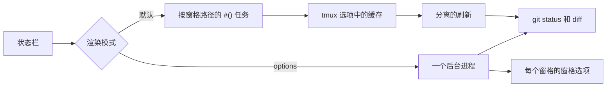

<div align="center">

# tmux-git-revamped

<strong>在 tmux 状态栏中显示活动窗格的 git 分支、改动和托管平台计数，且不阻塞渲染。</strong>

[English](README.md) &nbsp;|&nbsp; [日本語](README.ja.md) &nbsp;|&nbsp; 简体中文 &nbsp;|&nbsp; [繁體中文（香港）](README.zh-HK.md)

[](https://github.com/tmux-revamped/tmux-git-revamped/actions/workflows/tests.yml)
[](LICENSE)
[](CHANGELOG.md)

<p align="center">
  <a href="#功能">功能</a> &nbsp;|&nbsp;
  <a href="#环境要求">环境要求</a> &nbsp;|&nbsp;
  <a href="#安装">安装</a> &nbsp;|&nbsp;
  <a href="#用法">用法</a> &nbsp;|&nbsp;
  <a href="#配置">配置</a> &nbsp;|&nbsp;
  <a href="#按键绑定">按键绑定</a> &nbsp;|&nbsp;
  <a href="#工作原理">工作原理</a> &nbsp;|&nbsp;
  <a href="#开发">开发</a>
</p>

</div>

**2** 个占位符，分支名之后有 **21** 个片段，每个片段都有自己的颜色和图标选项，所有缓存值都保存在 tmux 选项中，而不是文件里。

---

## 功能

`#{git}` 显示活动窗格所在的仓库：先是分支，然后是改动的文件数、新增和删除的行数、未跟踪文件数、合并冲突数，以及正在进行的 rebase、merge、cherry-pick、revert、bisect 或 am。使用默认的 ASCII 图标时，有改动的工作树显示如下：

```text
main ~ 2 + 7 - 1 ? 3
```

可选片段可以加入已暂存文件、stash、相对 upstream 领先和落后的提交数、upstream 引用、领先于基准分支的提交数、链接 worktree 标记、有改动的子模块、最近一次提交距今的时间、干净工作树标记，以及来自 GitHub 或 GitLab 的开放拉取请求、评审请求、issue、bug 和 CI 状态。

在仓库之外，两个占位符都不显示任何内容。处于 detached HEAD 时，显示短提交哈希和最近的标签，而不是 `HEAD`。

## 环境要求

| 要求 | 版本或说明 |
|:------------|:----------------|
| tmux | 3.2 或更高 |
| bash | 3.2 或更高，因此 macOS 的 `/bin/bash` 可用 |
| git | 位于 `PATH` 中 |
| `gh` 或 `glab`，可选 | 需已登录，用于托管平台片段和 browse 动作 |
| lazygit，可选 | 用于 lazygit 动作 |
| [Nerd Font](https://www.nerdfonts.com)，可选 | 用于 `@git_revamped_icons 'nerd'` |

CI 在 Linux x86_64 和 arm64 上使用 GNU coreutils 和 uutils coreutils 运行测试套件，在 macOS Apple Silicon 和 Intel 上使用系统 BSD 工具、GNU coreutils 和 uutils coreutils 运行测试套件。

## 安装

使用 [TPM](https://github.com/tmux-plugins/tpm) 时，把插件加入 `~/.tmux.conf`，然后按 `prefix + I`：

```tmux
set -g @plugin 'tmux-revamped/tmux-git-revamped'
```

不使用 TPM 时，克隆仓库，并在 `~/.tmux.conf` 中运行入口脚本：

```sh
git clone https://github.com/tmux-revamped/tmux-git-revamped ~/.tmux/plugins/tmux-git-revamped
```

```tmux
run-shell ~/.tmux/plugins/tmux-git-revamped/git-revamped.tmux
```

请在插件加载之前设置 `status-left` 或 `status-right`，因为入口脚本会替换其中的占位符。

## 用法

在 `status-left` 或 `status-right` 中放入占位符：

```tmux
set -g status-right '#{git} | %H:%M'
```

| 占位符 | 输出 |
|:------------|:-------|
| `#{git}` | 活动窗格所在仓库的完整状态 |
| `#{git_branch}` | 仅分支名 |

开启需要的片段：

```tmux
set -g @git_revamped_ahead_behind '1'
set -g @git_revamped_stash '1'
set -g @git_revamped_web '1'
```

`doctor` 子命令会输出版本、路径是否为仓库、找到了 `git`、`gh`、`glab` 和 `lazygit` 中的哪些、检测到的托管平台，以及 tmux 是否支持弹出窗口：

```sh
~/.tmux/plugins/tmux-git-revamped/src/git.sh doctor "$PWD"
```

## 配置

| 选项 | 默认值 | 含义 |
|:-------|:--------|:--------|
| `@git_revamped_render` | 未设置 | 设为 `options` 时切换到工作原理一节所述的 options 渲染模式 |
| `@git_revamped_interval` | `5` | 缓存状态保持新鲜的秒数，也是 options 模式进程的周期 |
| `@git_revamped_max_branch` | `25` | 分支名被截断并以 `...` 结尾前的长度 |
| `@git_revamped_untracked` | `1` | 设为 `0` 隐藏未跟踪文件数 |
| `@git_revamped_staged` | `0` | 设为 `1` 显示已暂存文件数 |
| `@git_revamped_conflict` | `1` | 设为 `0` 隐藏冲突数 |
| `@git_revamped_state` | `1` | 设为 `0` 隐藏 rebase、merge、cherry-pick、revert、bisect 或 am 标签；rebase 和 am 以 `X/Y` 显示当前步骤 |
| `@git_revamped_stash` | `0` | 设为 `1` 显示 stash 数 |
| `@git_revamped_ahead_behind` | `0` | 设为 `1` 显示相对 upstream 领先和落后的提交数 |
| `@git_revamped_autofetch` | `0` | 设为 `1` 在后台运行 `git fetch --prune --tags`，使领先和落后数保持最新 |
| `@git_revamped_autofetch_interval` | `5` | 同一仓库两次后台 fetch 之间的分钟数 |
| `@git_revamped_last_commit` | `0` | 设为 `1` 以 `m`、`h` 或 `d` 显示最近一次提交距今的时间 |
| `@git_revamped_upstream` | `0` | 设为 `1` 显示 upstream 引用，分支没有 upstream 时显示 `local` |
| `@git_revamped_base_branch` | 空 | 一个分支名，例如 `main`；显示 `HEAD` 上不在该分支中的提交数 |
| `@git_revamped_worktree` | `0` | 设为 `1` 标记链接 worktree |
| `@git_revamped_submodule` | `0` | 设为 `1` 显示检出版本与记录的提交不一致的子模块数 |
| `@git_revamped_clean` | `0` | 设为 `1` 在没有改动和未跟踪文件时显示标记 |
| `@git_revamped_web` | `0` | 设为 `1` 加入托管平台片段 |
| `@git_revamped_web_interval` | `300` | 托管平台片段的缓存秒数 |
| `@git_revamped_web_zero` | `1` | 设为 `0` 隐藏为零的托管平台计数 |
| `@git_revamped_ci` | `1` | 设为 `0` 从托管平台片段中去掉 CI 状态 |
| `@git_revamped_gh_accounts` | 空 | 以空格分隔的 `owner=account` 对，为仓库所有者指定 `gh` 账号 |
| `@git_revamped_key_menu` | `M-v` | 分支菜单的按键；设为 `''` 则不绑定 |
| `@git_revamped_key_lazygit` | 未设置 | lazygit 动作的按键 |
| `@git_revamped_key_browse` | 未设置 | browse 动作的按键 |
| `@git_revamped_before` | 空 | 仅在状态非空时放在状态之前的格式 |
| `@git_revamped_after` | 空 | 仅在状态非空时放在状态之后的格式 |
| `@git_revamped_reset` | `#[default]` | 结束每个片段的样式；设为普通的 `#[fg=...]` 可保留 `@git_revamped_before` 设置的背景 |
| `@git_revamped_icons` | `ascii` | 默认图标集：`ascii` 或 `nerd` |

### 片段样式

每个片段读取 `@git_revamped_<kind>_color` 和 `@git_revamped_<kind>_icon`。图标选项设为 `''` 时只显示值。分支名读取 `@git_revamped_branch_color` 和 `@git_revamped_branch_icon`，两者默认都为空。

| 类型 | 默认颜色 | `ascii` 图标 | `nerd` 字形 |
|:-----|:--------------|:-------------|:-------------|
| `branch` | 无 | 无 | 无 |
| `changed` | yellow | `~` | `oct-diff_modified` |
| `insertions` | green | `+` | `oct-diff_added` |
| `deletions` | red | `-` | `oct-diff_removed` |
| `untracked` | blue | `?` | `md-file_question_outline` |
| `staged` | green | `S` | `md-check_all` |
| `conflict` | red | `!` | `oct-alert` |
| `state` | yellow | 无 | `oct-git_merge` |
| `stash` | magenta | `$` | `md-archive` |
| `ahead` | green | `^` | `md-arrow_up` |
| `behind` | yellow | `v` | `md-arrow_down` |
| `commit` | blue | `@` | `oct-history` |
| `upstream` | cyan | `->` | `oct-git_compare` |
| `noupstream` | yellow | `!` | `md-cloud_off_outline` |
| `divergence` | magenta | `~>` | `md-source_fork` |
| `worktree` | cyan | `wt` | `md-folder_multiple_outline` |
| `submodule` | yellow | `sub` | `oct-file_submodule` |
| `clean` | green | `ok` | `md-check` |
| `pr` | cyan | `PR` | `oct-git_pull_request` |
| `review` | magenta | `R` | `oct-eye` |
| `issue` | blue | `I` | `oct-issue_opened` |
| `bug` | red | `B` | `fa-bug` |

worktree 和 clean 片段是标记，只显示图标。颜色使用 16 个 ANSI 颜色名，因此会跟随终端主题。

CI 状态有自己的选项。`@git_revamped_ci_pass_color`、`@git_revamped_ci_fail_color` 和 `@git_revamped_ci_pending_color` 默认分别为 green、red 和 yellow。`@git_revamped_ci_<status>_icon` 默认为 `CI`，使用 Nerd Font 图标时为 `md-check_circle`、`md-close_circle` 和 `md-clock_outline`。`@git_revamped_ci_<status>_label` 默认为状态名，标签为空时只显示图标。

### 托管平台片段

`@git_revamped_web` 设为 `1` 后，状态会加入开放的拉取请求、评审请求、分配给你的 issue 以及当前分支的 CI 状态。GitHub 通过 `gh`，GitLab 通过 `glab`，命令在活动窗格所在的仓库中运行。在 GitHub 上，带有 `bug` 标签的已分配 issue 单独成为一个片段，不计入 issue 数。GitHub 列表最多请求 1000 项，GitLab 列表最多读取 10 页、每页 100 项。

托管平台从 `remote.origin.url` 判断。`git@github-work:owner/repo.git` 这样的 SSH 主机别名通过 `ssh -G` 解析。在 GitHub 上，账号依次取：项目的 `user.email` 为 `299237933+octocat@users.noreply.github.com` 这类 noreply 地址时其中的登录名，然后是仓库所有者在 `@git_revamped_gh_accounts` 中的条目，最后是 `gh` 当前的活动账号。令牌来自 `gh auth token --user <account>`，因此每个账号都必须已登录 `gh`。

运行超过 10 秒的托管平台调用会被终止，屏幕上保留上一次的值。每次刷新都会调用托管平台的 API，调用频率由 `@git_revamped_web_interval` 决定。

### 主题配色

在仓库之外会消失的 Catppuccin 胶囊在状态前后开合，并在各片段之间保持背景：

```tmux
set -g @git_revamped_before "#[fg=#{@thm_peach}]#{@catppuccin_status_left_separator}#[fg=#{@thm_crust},bg=#{@thm_peach}]\U000f02a2 #{@catppuccin_status_middle_separator}#[fg=#{@thm_fg},bg=#{@thm_surface_0}] "
set -g @git_revamped_after '#[fg=#{@thm_surface_0}]#{@catppuccin_status_right_separator}'
set -g @git_revamped_reset '#[fg=#{@thm_fg}]'
```

如需精确的十六进制颜色，把下面任意一段复制到 `~/.tmux.conf`。

#### Catppuccin Mocha

```tmux
set -g @git_revamped_insertions_color '#[fg=#a6e3a1]'
set -g @git_revamped_ahead_color '#[fg=#a6e3a1]'
set -g @git_revamped_changed_color '#[fg=#f9e2af]'
set -g @git_revamped_behind_color '#[fg=#f9e2af]'
set -g @git_revamped_deletions_color '#[fg=#f38ba8]'
set -g @git_revamped_bug_color '#[fg=#f38ba8]'
set -g @git_revamped_untracked_color '#[fg=#89b4fa]'
set -g @git_revamped_commit_color '#[fg=#89b4fa]'
set -g @git_revamped_issue_color '#[fg=#89b4fa]'
set -g @git_revamped_pr_color '#[fg=#94e2d5]'
set -g @git_revamped_stash_color '#[fg=#cba6f7]'
set -g @git_revamped_review_color '#[fg=#cba6f7]'
```

#### Dracula

```tmux
set -g @git_revamped_insertions_color '#[fg=#50fa7b]'
set -g @git_revamped_ahead_color '#[fg=#50fa7b]'
set -g @git_revamped_changed_color '#[fg=#f1fa8c]'
set -g @git_revamped_behind_color '#[fg=#f1fa8c]'
set -g @git_revamped_deletions_color '#[fg=#ff5555]'
set -g @git_revamped_bug_color '#[fg=#ff5555]'
set -g @git_revamped_untracked_color '#[fg=#bd93f9]'
set -g @git_revamped_commit_color '#[fg=#bd93f9]'
set -g @git_revamped_issue_color '#[fg=#bd93f9]'
set -g @git_revamped_pr_color '#[fg=#8be9fd]'
set -g @git_revamped_stash_color '#[fg=#ff79c6]'
set -g @git_revamped_review_color '#[fg=#ff79c6]'
```

#### Nord

```tmux
set -g @git_revamped_insertions_color '#[fg=#a3be8c]'
set -g @git_revamped_ahead_color '#[fg=#a3be8c]'
set -g @git_revamped_changed_color '#[fg=#ebcb8b]'
set -g @git_revamped_behind_color '#[fg=#ebcb8b]'
set -g @git_revamped_deletions_color '#[fg=#bf616a]'
set -g @git_revamped_bug_color '#[fg=#bf616a]'
set -g @git_revamped_untracked_color '#[fg=#81a1c1]'
set -g @git_revamped_commit_color '#[fg=#81a1c1]'
set -g @git_revamped_issue_color '#[fg=#81a1c1]'
set -g @git_revamped_pr_color '#[fg=#88c0d0]'
set -g @git_revamped_stash_color '#[fg=#b48ead]'
set -g @git_revamped_review_color '#[fg=#b48ead]'
```

#### Gruvbox Dark

```tmux
set -g @git_revamped_insertions_color '#[fg=#b8bb26]'
set -g @git_revamped_ahead_color '#[fg=#b8bb26]'
set -g @git_revamped_changed_color '#[fg=#fabd2f]'
set -g @git_revamped_behind_color '#[fg=#fabd2f]'
set -g @git_revamped_deletions_color '#[fg=#fb4934]'
set -g @git_revamped_bug_color '#[fg=#fb4934]'
set -g @git_revamped_untracked_color '#[fg=#83a598]'
set -g @git_revamped_commit_color '#[fg=#83a598]'
set -g @git_revamped_issue_color '#[fg=#83a598]'
set -g @git_revamped_pr_color '#[fg=#8ec07c]'
set -g @git_revamped_stash_color '#[fg=#d3869b]'
set -g @git_revamped_review_color '#[fg=#d3869b]'
```

#### Tokyo Night

```tmux
set -g @git_revamped_insertions_color '#[fg=#9ece6a]'
set -g @git_revamped_ahead_color '#[fg=#9ece6a]'
set -g @git_revamped_changed_color '#[fg=#e0af68]'
set -g @git_revamped_behind_color '#[fg=#e0af68]'
set -g @git_revamped_deletions_color '#[fg=#f7768e]'
set -g @git_revamped_bug_color '#[fg=#f7768e]'
set -g @git_revamped_untracked_color '#[fg=#7aa2f7]'
set -g @git_revamped_commit_color '#[fg=#7aa2f7]'
set -g @git_revamped_issue_color '#[fg=#7aa2f7]'
set -g @git_revamped_pr_color '#[fg=#7dcfff]'
set -g @git_revamped_stash_color '#[fg=#bb9af7]'
set -g @git_revamped_review_color '#[fg=#bb9af7]'
```

#### Solarized Dark

```tmux
set -g @git_revamped_insertions_color '#[fg=#859900]'
set -g @git_revamped_ahead_color '#[fg=#859900]'
set -g @git_revamped_changed_color '#[fg=#b58900]'
set -g @git_revamped_behind_color '#[fg=#b58900]'
set -g @git_revamped_deletions_color '#[fg=#dc322f]'
set -g @git_revamped_bug_color '#[fg=#dc322f]'
set -g @git_revamped_untracked_color '#[fg=#268bd2]'
set -g @git_revamped_commit_color '#[fg=#268bd2]'
set -g @git_revamped_issue_color '#[fg=#268bd2]'
set -g @git_revamped_pr_color '#[fg=#2aa198]'
set -g @git_revamped_stash_color '#[fg=#d33682]'
set -g @git_revamped_review_color '#[fg=#d33682]'
```

### 内部状态

这些选项由插件自行管理，请勿设置。

| 选项 | 保存内容 |
|:-------|:------|
| `@git_revamped_published` | 状态栏使用的指标，以空格分隔，在加载时写入，options 渲染模式只发布这些指标 |
| `@git_revamped_out_status`、`@git_revamped_out_branch` | options 渲染模式下保存每个窗格渲染结果的窗格选项 |
| `@git_revamped_ticker_pid` | options 模式后台进程的进程 ID；默认模式下在加载时清除，使旧进程退出 |
| `@git_revamped_option_names` | 后台进程每个周期用一次调用读取的选项名 |
| `@git_revamped_status_*`、`@git_revamped_web_status_*`、`@git_revamped_fetch_status_*` | 每个仓库缓存的状态、托管平台片段和上次 fetch 时间，以路径的校验和为键，并带有 `_ts` 和 `_lock` 配套选项 |

## 按键绑定

| 按键 | 动作 | 默认 |
|:----|:-------|:--------|
| `prefix + M-v` | 分支菜单：列出本地分支并检出所选分支，工作树有改动时拒绝执行 | 已绑定 |
| `@git_revamped_key_lazygit` | 在以窗格目录为根的 90% 弹出窗口中打开 lazygit | 未绑定 |
| `@git_revamped_key_browse` | 通过 `gh browse` 或 `glab repo view --web` 在浏览器中打开仓库 | 未绑定 |

`M-v` 是本插件在家族按键分配中的位置，取 version control 之意，因为 `g` 已被占用。每个动作只在窗格位于仓库中且所需工具已安装时运行。

```tmux
set -g @git_revamped_key_lazygit 'g'
set -g @git_revamped_key_browse 'o'
```

## 工作原理



入口脚本 [`git-revamped.tmux`](git-revamped.tmux) 替换 `status-left` 和 `status-right` 中的每个占位符。

在默认模式下，占位符会变成以 `#{q:pane_current_path}` 调用 [`src/git.sh`](src/git.sh) 的 `#()`。该调用立即输出该路径的缓存值。缓存值早于 `@git_revamped_interval` 时，会启动一次分离的刷新，运行 `git status`、`git diff --numstat` 等读取，全部带有 `--no-optional-locks`。锁选项保证同一仓库不会同时运行两次刷新。tmux 会为每个新路径启动新任务，因此当前台程序在另一个目录中工作时，该片段会在任务完成前显示为空。

`@git_revamped_render` 设为 `options` 时，占位符会变成 `#{E:@git_revamped_out_status}` 或 `#{E:@git_revamped_out_branch}`。每个服务器有一个后台进程，每隔 `@git_revamped_interval` 秒遍历所有窗格，并把每个窗格的值写成窗格选项，因此切换窗格时会立即显示该窗格的仓库。位于仓库之外的窗格保留上一次的值。服务器停止时，该进程在当前周期结束后退出；重新加载配置时会替换它。

分支名、标签名和 upstream 名称在进入状态栏前，其中的每个 `#` 都会加倍，因此 `fix/#(cmd)` 这样的名称会按原样显示。

## 开发

| 命令 | 运行内容 |
|:--------|:-------------|
| `make test` | [`test/`](test) 下的 bats 测试套件 |
| `make lint` | 对所有 shell 文件和 [`family/bin/`](family/bin) 以 warning 级别运行 shellcheck |
| `make coverage` | 在 Linux 上用 kcov 统计行覆盖率，低于 95% 时失败 |

[`src/lib/git/git.sh`](src/lib/git/git.sh) 中的解析器和 [`src/lib/git/render.sh`](src/lib/git/render.sh) 中的渲染器是处理 git 输出的纯函数。git、`gh` 和 `glab` 调用都位于小型包装函数之后，因此大多数测试既不需要仓库，也不需要网络。

## 许可证

[MIT](LICENSE)，copyright Gustavo Franco。

<!-- family:begin -->

## tmux-revamped 插件家族

本插件是 tmux-revamped 插件家族的成员。每个成员都带有 [`FAMILY.md`](FAMILY.md) 中的同一份约定、`family/` 下的同一套工具和同一个共享库，并由校验和清单保持逐字节一致。这些插件设计为一起安装：任何成员都不会占用其他成员已占用的按键或 tmux 选项。

在一个成员中发现的缺陷，要在所有成员中排查后才算修复完成。这项义务写在约定里，而不是靠记忆，`family/bin/sweep` 就是履行它的工具。

| 成员 | 功能 |
|---|---|
| [`tmux-autoreload-revamped`](https://github.com/tmux-revamped/tmux-autoreload-revamped) | 编辑并保存 tmux 配置后会自动重新加载，无需按键，也无需命令 |
| [`tmux-battery-revamped`](https://github.com/tmux-revamped/tmux-battery-revamped) | 在 tmux 状态栏显示电池状态，从不阻塞状态栏渲染 |
| [`tmux-bluetooth-revamped`](https://github.com/tmux-revamped/tmux-bluetooth-revamped) | 在 tmux 状态栏显示每个已连接的蓝牙设备及其电量，不阻塞渲染 |
| [`tmux-cpu-revamped`](https://github.com/tmux-revamped/tmux-cpu-revamped) | 在 tmux 状态栏显示 CPU 负载、温度和频率，从不阻塞渲染 |
| [`tmux-disk-revamped`](https://github.com/tmux-revamped/tmux-disk-revamped) | 在 tmux 状态栏显示磁盘用量，从不阻塞状态栏渲染 |
| [`tmux-extract-revamped`](https://github.com/tmux-revamped/tmux-extract-revamped) | 用 fzf 从屏幕上挑选 URL、路径、哈希或任意其他词元，并输入到光标处，全部用纯 shell 实现 |
| [`tmux-fzf-revamped`](https://github.com/tmux-revamped/tmux-fzf-revamped) | 在弹出窗口中的 fzf 选择器里切换、关闭、重命名或创建 tmux 会话、窗口和窗格 |
| [`tmux-git-revamped`](https://github.com/tmux-revamped/tmux-git-revamped) | **本插件**，在 tmux 状态栏中显示活动窗格的 git 分支、改动和托管平台计数，且不阻塞渲染 |
| [`tmux-gpu-revamped`](https://github.com/tmux-revamped/tmux-gpu-revamped) | 在 tmux 状态栏中显示 NVIDIA、AMD、Intel 和 Apple GPU 的负载、温度、频率、功耗和显存 |
| [`tmux-kube-revamped`](https://github.com/tmux-revamped/tmux-kube-revamped) | 在 tmux 状态栏中显示当前的 Kubernetes 上下文和命名空间，不依赖 kubectl，直接解析 kubeconfig |
| [`tmux-launcher-revamped`](https://github.com/tmux-revamped/tmux-launcher-revamped) | 在弹出窗口或新窗口中启动任意 TUI 应用，从当前窗格的目录开始，每个应用可配置一个按键 |
| [`tmux-logging-revamped`](https://github.com/tmux-revamped/tmux-logging-revamped) | 将任意窗格保存到文件：实时日志、完整回滚缓冲区或一次性截图 |
| [`tmux-music-revamped`](https://github.com/tmux-revamped/tmux-music-revamped) | 在 tmux 状态栏显示正在播放的曲目，从不阻塞状态栏渲染 |
| [`tmux-network-revamped`](https://github.com/tmux-revamped/tmux-network-revamped) | 在 tmux 状态栏显示网络吞吐量，从不阻塞渲染 |
| [`tmux-pain-control-revamped`](https://github.com/tmux-revamped/tmux-pain-control-revamped) | tmux 的标准窗格和窗口管理按键，适配 tmux 版本，兼容 vim，全部可配置 |
| [`tmux-persist-revamped`](https://github.com/tmux-revamped/tmux-persist-revamped) | 保存每个 tmux 会话、窗口和窗格，按定时器自动保存，并在重启后全部恢复 |
| [`tmux-plugin-template`](https://github.com/tmux-revamped/tmux-plugin-template) | 用于构建不阻塞的 tmux 状态栏插件的模板 |
| [`tmux-pomodoro-revamped`](https://github.com/tmux-revamped/tmux-pomodoro-revamped) | 显示在 tmux 状态栏的番茄钟，所有状态都保存在 tmux 选项中，不使用临时文件 |
| [`tmux-ram-revamped`](https://github.com/tmux-revamped/tmux-ram-revamped) | 在 tmux 状态栏显示内存、交换空间和内存压力，在后台采样，渲染从不等待 |
| [`tmux-reorder-revamped`](https://github.com/tmux-revamped/tmux-reorder-revamped) | 用鼠标沿 tmux 状态栏拖动窗口标签来移动该窗口 |
| [`tmux-scroll-revamped`](https://github.com/tmux-revamped/tmux-scroll-revamped) | 把鼠标滚轮发送给能自行滚动的应用，其他地方则进入 tmux 复制模式 |
| [`tmux-sensible-revamped`](https://github.com/tmux-revamped/tmux-sensible-revamped) | 按 tmux 版本和终端启用的合理默认设置，不改动你自己设置的选项 |
| [`tmux-tiling-revamped`](https://github.com/tmux-revamped/tmux-tiling-revamped) | tmux 的 BSP 平铺窗口管理，8 种布局、19 种操作，零依赖 |
| [`tmux-time-revamped`](https://github.com/tmux-revamped/tmux-time-revamped) | 用于 tmux 状态栏的本地时钟和世界时钟，按一天中的时段着色，并提供倒计时和夏令时提醒 |
| [`tmux-weather-revamped`](https://github.com/tmux-revamped/tmux-weather-revamped) | 在 tmux 状态栏显示来自 wttr.in 的天气，数据在后台获取，状态栏从不等待 |

### 检查安装

所有成员都在磁盘上时，一条命令即可报告它们之间的任何冲突：

```sh
family/bin/doctor --live
```

它会读取每个成员和正在运行的 tmux 服务器，报告重复的按键、重复的状态栏占位符、不符合命名规则的选项，以及约定版本落后的成员。

<!-- family:end -->
